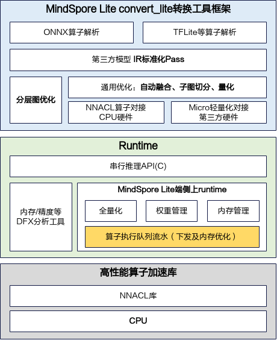
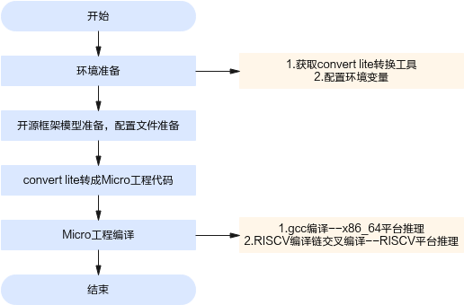

# 前言<a name="ZH-CN_TOPIC_0000002451492226"></a>

**概述<a name="section4537382116410"></a>**

本文档介绍如何在HiSpark系列MCU上，基于MindSpore Lite Enterprise Micro v106版本，实现第三方开源框架（如TFLite、ONNX等）网络模型的轻量化部署与推理任务。Converter\_lite是MindSpore Lite Enterprise Micro的转换工具，基于一系列内存/算子优化技术，生成适配HiSpark MCU上可执行的Micro模块代码。基于Converter\_lite，在服务器端能够将模型转换为可在x86 / RISCV/ARM平台（x86部署可以为板端调试提供精度标杆）上部署的Micro工程代码，从而脱离在线解析模型和图编译，具有运行时内存小、代码轻量化等特点。

通过本文档，您将能够实现以下目标：

-   了解不同开源框架网络模型离线转换Micro工程代码的方法。
-   能够基于本文档的参数配置，转成量化或非量化的Micro工程代码。
-   能够基于Micro工程代码在x86/RISCV/ARM平台侧（x86部署可以为板端调试提供精度标杆）做部署推理。

掌握以下经验和技能可以更好理解本文档：

-   熟悉Linux基本命令。
-   对机器学习、人工智能有一定的了解。
-   有一定的C++工程开发经验。

**读者对象<a name="section4378592816410"></a>**

本文档适用于使用MindSpore Lite Enterprise Micro v106工具进行AI模型端侧部署的人员，本文档适用于以下工程师：

-   技术支持工程师
-   软件工程师
-   硬件工程师

**符号约定<a name="section133020216410"></a>**

在本文中可能出现下列标志，它们所代表的含义如下。

<a name="table2622507016410"></a>
<table><thead align="left"><tr id="row1530720816410"><th class="cellrowborder" valign="top" width="20.580000000000002%" id="mcps1.1.3.1.1"><p id="p6450074116410"><a name="p6450074116410"></a><a name="p6450074116410"></a><strong id="b2136615816410"><a name="b2136615816410"></a><a name="b2136615816410"></a>符号</strong></p>
</th>
<th class="cellrowborder" valign="top" width="79.42%" id="mcps1.1.3.1.2"><p id="p5435366816410"><a name="p5435366816410"></a><a name="p5435366816410"></a><strong id="b5941558116410"><a name="b5941558116410"></a><a name="b5941558116410"></a>说明</strong></p>
</th>
</tr>
</thead>
<tbody><tr id="row1372280416410"><td class="cellrowborder" valign="top" width="20.580000000000002%" headers="mcps1.1.3.1.1 "><p id="p3734547016410"><a name="p3734547016410"></a><a name="p3734547016410"></a><a name="image2670064316410"></a><a name="image2670064316410"></a><span></span></p>
</td>
<td class="cellrowborder" valign="top" width="79.42%" headers="mcps1.1.3.1.2 "><p id="p1757432116410"><a name="p1757432116410"></a><a name="p1757432116410"></a>表示如不避免则将会导致死亡或严重伤害的具有高等级风险的危害。</p>
</td>
</tr>
<tr id="row466863216410"><td class="cellrowborder" valign="top" width="20.580000000000002%" headers="mcps1.1.3.1.1 "><p id="p1432579516410"><a name="p1432579516410"></a><a name="p1432579516410"></a><a name="image4895582316410"></a><a name="image4895582316410"></a><span></span></p>
</td>
<td class="cellrowborder" valign="top" width="79.42%" headers="mcps1.1.3.1.2 "><p id="p959197916410"><a name="p959197916410"></a><a name="p959197916410"></a>表示如不避免则可能导致死亡或严重伤害的具有中等级风险的危害。</p>
</td>
</tr>
<tr id="row123863216410"><td class="cellrowborder" valign="top" width="20.580000000000002%" headers="mcps1.1.3.1.1 "><p id="p1232579516410"><a name="p1232579516410"></a><a name="p1232579516410"></a><a name="image1235582316410"></a><a name="image1235582316410"></a><span></span></p>
</td>
<td class="cellrowborder" valign="top" width="79.42%" headers="mcps1.1.3.1.2 "><p id="p123197916410"><a name="p123197916410"></a><a name="p123197916410"></a>表示如不避免则可能导致轻微或中度伤害的具有低等级风险的危害。</p>
</td>
</tr>
<tr id="row5786682116410"><td class="cellrowborder" valign="top" width="20.580000000000002%" headers="mcps1.1.3.1.1 "><p id="p2204984716410"><a name="p2204984716410"></a><a name="p2204984716410"></a><a name="image4504446716410"></a><a name="image4504446716410"></a><span></span></p>
</td>
<td class="cellrowborder" valign="top" width="79.42%" headers="mcps1.1.3.1.2 "><p id="p4388861916410"><a name="p4388861916410"></a><a name="p4388861916410"></a>用于传递设备或环境安全警示信息。如不避免则可能会导致设备损坏、数据丢失、设备性能降低或其它不可预知的结果。</p>
<p id="p1238861916410"><a name="p1238861916410"></a><a name="p1238861916410"></a>“须知”不涉及人身伤害。</p>
</td>
</tr>
<tr id="row2856923116410"><td class="cellrowborder" valign="top" width="20.580000000000002%" headers="mcps1.1.3.1.1 "><p id="p5555360116410"><a name="p5555360116410"></a><a name="p5555360116410"></a><a name="image799324016410"></a><a name="image799324016410"></a><span></span></p>
</td>
<td class="cellrowborder" valign="top" width="79.42%" headers="mcps1.1.3.1.2 "><p id="p4612588116410"><a name="p4612588116410"></a><a name="p4612588116410"></a>对正文中重点信息的补充说明。</p>
<p id="p1232588116410"><a name="p1232588116410"></a><a name="p1232588116410"></a>“说明”不是安全警示信息，不涉及人身、设备及环境伤害信息。</p>
</td>
</tr>
</tbody>
</table>

**修改记录<a name="section2467512116410"></a>**

| 文档版本 | 发布日期 | 修改说明 |
| :--- | :--- | :--- |
| 07 | 2026-08-30 | 新增Onnx/TFLite算子规格：<br>新增“[ConvTranspose](#ZH-CN_TOPIC_0000002026082902)、[TransposeConv](#ZH-CN_TOPIC_0000002026082901)”。<br>新增“[BitShift](#ZH-CN_TOPIC_0000003090100001)、[Tan](#ZH-CN_TOPIC_0000003100115802)、[ReduceSumSquare](#ZH-CN_TOPIC_0000003090100002)、[RNN](#ZH-CN_TOPIC_0000002026082903)”。<br>新增“[Conv3D](#ZH-CN_TOPIC_0000003190115802)、[Conv3D](#ZH-CN_TOPIC_0000003190115702)”。<br>新增“[GatherND](#ZH-CN_TOPIC_0000003200115802)、[GatherNd](#ZH-CN_TOPIC_0000002026082401)”。<br>新增“[Scatter](#ZH-CN_TOPIC_0000003150115802)、[ScatterElements](#ZH-CN_TOPIC_0000003160115802)、[ScatterND](#ZH-CN_TOPIC_0000003170115802)、[ScatterND](#ZH-CN_TOPIC_0000003150115702)”。<br>新增“[QLinearMatMul](#ZH-CN_TOPIC_0000003130115802)、[QLinearConv](#ZH-CN_TOPIC_0000003140115802)、[Selu](#ZH-CN_TOPIC_0000003180115802)”。<br>新增“[Constant](#ZH-CN_TOPIC_0000003110115802)、[ConstantOfShape](#ZH-CN_TOPIC_0000003120115802)”。<br>新增“[Max](#ZH-CN_TOPIC_0000003060115802)、[Maximum](#ZH-CN_TOPIC_0000003060115702)、[Min](#ZH-CN_TOPIC_0000003070115802)、[Minimum](#ZH-CN_TOPIC_0000003070115702)、[Sum](#ZH-CN_TOPIC_0000003080115802)、[ReduceProd](#ZH-CN_TOPIC_0000003090115802)、[ReduceProd](#ZH-CN_TOPIC_0000003090115702)”。<br>新增“[OneHot](#ZH-CN_TOPIC_0000002026082105)、[OneHot](#ZH-CN_TOPIC_0000002026082104)、[Unique](#ZH-CN_TOPIC_0000002026082108)、[Unique](#ZH-CN_TOPIC_0000002026082107)、[Where](#ZH-CN_TOPIC_0000002026082102)、[ConvInteger](#ZH-CN_TOPIC_0000002026082103)、[GatherNd](#ZH-CN_TOPIC_0000002026082401)”。<br>新增“[LogSoftmax](#ZH-CN_TOPIC_0000002026082405)、[LogSoftmax](#ZH-CN_TOPIC_0000002026082404)、[Hardmax](#ZH-CN_TOPIC_0000002026082101)、[Softsign](#ZH-CN_TOPIC_0000002026082402)、[Softplus](#ZH-CN_TOPIC_0000002026082403)、[ThresholdedRelu](#ZH-CN_TOPIC_0000002026082106)”。 |
| 06 | 2026-07-30 | 新增Onnx/TFLite算子规格：<br>新增“[Erf](#ZH-CN_TOPIC_0000002026072801)、[HardSigmoid](#ZH-CN_TOPIC_0000002026072802)、[Celu](#ZH-CN_TOPIC_0000002026072803)”。<br>新增"[Shape](#ZH-CN_TOPIC_0000003030115802)、[Shape](#ZH-CN_TOPIC_0000003030115702)"。<br>新增"[MatMulInteger](#ZH-CN_TOPIC_0000003040115702)"。<br>新增"[TopK](#ZH-CN_TOPIC_0000003050115802)、[TopK](#ZH-CN_TOPIC_0000003050115702)"。<br>新增"[Gelu](#ZH-CN_TOPIC_0000002661401191)、[Gelu](#ZH-CN_TOPIC_0000002661401194)、[Trilu](#ZH-CN_TOPIC_0000002661401195)、[Pack](#ZH-CN_TOPIC_0000002661401192)、[Unpack](#ZH-CN_TOPIC_0000002661401193)"。<br>新增"[Fill](#ZH-CN_TOPIC_0000002800000001)、[Neg](#ZH-CN_TOPIC_0000002900000001)、[Pow](#ZH-CN_TOPIC_0000002476598365)、[Neg](#ZH-CN_TOPIC_0000002900000002)、[Pow](#ZH-CN_TOPIC_0000002476598371)"。<br>新增"[Select](#ZH-CN_TOPIC_0000002600000001)、[SelectV2](#ZH-CN_TOPIC_0000002600000002)、[ReverseV2](#ZH-CN_TOPIC_0000002600000003)、[Mod](#ZH-CN_TOPIC_0000002600000004)、[ReduceL1](#ZH-CN_TOPIC_0000002600000005)、[ReduceL2](#ZH-CN_TOPIC_0000002600000006)"。<br>新增训练特性：<br>在“[开源框架的TFLite/ONNX模型转换为Micro工程](#ZH-CN_TOPIC_0000002353945877)”中更新QAS INT8量化训练配置、FP32训练配置。<br>在“[参数说明](#ZH-CN_TOPIC_0000002319906348)”中更新训练参数，新增MSE loss和Adam优化器参数。<br>新增QAS INT8和FP32训练支持规格。 |
| 05 | 2026-07-03 | 更新“[设置环境变量](#ZH-CN_TOPIC_0000002353775693)、[限制与约束](#ZH-CN_TOPIC_0000002319976756)”。<br>在“[开源框架的TFLite/ONNX模型转换为Micro工程](#ZH-CN_TOPIC_0000002353945877)”中更新[5](#设置Micro配置项)。<br>新增“[ARM平台编译部署](#ZH-CN_TOPIC_0000002590121500)”小节。<br>在“[输入选项](#ZH-CN_TOPIC_0000002353985081)”中更新[表1](#table3808173922715)。<br>更新“[算子规格参考](#ZH-CN_TOPIC_0000002354161329)”。<br>新增“[专题](#ZH-CN_TOPIC_0000002562713759)”章节。 |
| 04 | 2026-06-01 | 新增Onnx/TFLite算子规格：<br>更新“[PRelu](#ZH-CN_TOPIC_0000002568693026)、[PRelu](#ZH-CN_TOPIC_0000002568693026)、[CumSum](#ZH-CN_TOPIC_0000002599292569)、[ReverseSequence](#ZH-CN_TOPIC_0000002599187919)、[CumSum](#ZH-CN_TOPIC_0000002568533372)、[ReverseSequence](#ZH-CN_TOPIC_0000002599187805)、[Einsum](#ZH-CN_TOPIC_0000002599307751)”。<br>更新“[Relu6](#ZH-CN_TOPIC_0000002574010852)、[LeakyRelu](#ZH-CN_TOPIC_0000002604689955)、[HardSwish](#ZH-CN_TOPIC_0000002574309498)、[LeakyRelu](#ZH-CN_TOPIC_0000002574170496)、[HardSwish](#ZH-CN_TOPIC_0000002574469146)、[Swish](#ZH-CN_TOPIC_0000002605108551)”。<br>更新“[LogicalAnd](#ZH-CN_TOPIC_0000002574976868)、[Equal](#ZH-CN_TOPIC_0000002605336325)、[GreaterEqual](#ZH-CN_TOPIC_0000002574817236)、[Greater](#ZH-CN_TOPIC_0000002605456261)、[LessEqual](#ZH-CN_TOPIC_0000002574976872)、[Less](#ZH-CN_TOPIC_0000002605336331)、[NotEqual](#ZH-CN_TOPIC_0000002574817240)、[LogicalNot](#ZH-CN_TOPIC_0000002605456267)、[LogicalOr](#ZH-CN_TOPIC_0000002574976878)、[And](#ZH-CN_TOPIC_0000002574578826) 、[GreaterOrEqual](#ZH-CN_TOPIC_0000002605377849)、[Greater](#ZH-CN_TOPIC_0000002574738452)、[LessOrEqual](#ZH-CN_TOPIC_0000002574578828)、[Less](#ZH-CN_TOPIC_0000002605257909)、[Not](#ZH-CN_TOPIC_0000002605377851)、[Or](#ZH-CN_TOPIC_0000002574738488)、[Xor](#ZH-CN_TOPIC_0000002574578874)”。<br>更新“[Dropout](#ZH-CN_TOPIC_0000002659215655) [Identity](#ZH-CN_TOPIC_0000002628696446) [GatherElements](#ZH-CN_TOPIC_0000002659095703) [ReduceLogSum](#ZH-CN_TOPIC_0000002628856352) [ReduceLogSumExp](#ZH-CN_TOPIC_0000002659215657) [Expand](#ZH-CN_TOPIC_0000002628696448) [Elu](#ZH-CN_TOPIC_0000002660394575) [Elu](#ZH-CN_TOPIC_0000002660274969)”。<br>更新“[DepthToSpace](#ZH-CN_TOPIC_0000002629955352) [SpaceToDepth](#ZH-CN_TOPIC_0000002660274511) [GRU](#ZH-CN_TOPIC_0000002631448488) [DepthToSpace](#ZH-CN_TOPIC_0000002660395017) [SpaceToDepth](#ZH-CN_TOPIC_0000002630115702)”。 |
| 03 | 2026-03-24 | 新增Onnx/TFLite算子规格：<br>更新“[ArgMax](#ZH-CN_TOPIC_0000002510106182)、[ArgMin](#ZH-CN_TOPIC_0000002541586163)、[ArgMax](#ZH-CN_TOPIC_0000002509946184)、[ArgMin](#ZH-CN_TOPIC_0000002541666173)”。<br>更新“[Div](#ZH-CN_TOPIC_0000002516261490)、[Clip](#ZH-CN_TOPIC_0000002552815891)、[Cast](#ZH-CN_TOPIC_0000002526464964)、[Div](#ZH-CN_TOPIC_0000002516421386)、[Cast](#ZH-CN_TOPIC_0000002557544885)”。<br>更新“[ReduceMax](#ZH-CN_TOPIC_0000002557401349)、[ReduceMin](#ZH-CN_TOPIC_0000002526441430)、[ReduceSum](#ZH-CN_TOPIC_0000002557481311)、[ReduceMean](#ZH-CN_TOPIC_0000002526281478)、[ReduceMax](#ZH-CN_TOPIC_0000002526421590)、[Sum](#ZH-CN_TOPIC_0000002557400507)、[Mean](#ZH-CN_TOPIC_0000002557400907)”。<br>更新“[Quantize](#ZH-CN_TOPIC_0000002557589767)、[Dequantize](#ZH-CN_TOPIC_0000002526509914)”。<br>更新“[Conv优化](#ZH-CN_TOPIC_0000002531633886)”。 |
| 02 | 2025-12-18 | 新增Onnx/TFLite算子规格：<br>更新“[Squeeze](#ZH-CN_TOPIC_0000002482800962)、[Unsqueeze](#ZH-CN_TOPIC_0000002482804754)、[Flatten](#ZH-CN_TOPIC_0000002515124725)、[Squeeze](#ZH-CN_TOPIC_0000002515130287)、[ExpandDims](#ZH-CN_TOPIC_0000002482930280)、[Slice](#ZH-CN_TOPIC_0000002528453623) [Slice](#ZH-CN_TOPIC_0000002528693597)”。<br>更新“[Abs](#ZH-CN_TOPIC_0000002485239888)、[Ceil](#ZH-CN_TOPIC_0000002517399797)、[Cos](#ZH-CN_TOPIC_0000002517479775)、[Exp](#ZH-CN_TOPIC_0000002485399854)、[Floor](#ZH-CN_TOPIC_0000002485239890)、[Log](#ZH-CN_TOPIC_0000002517399799)、[Round](#ZH-CN_TOPIC_0000002517479777)、[Sin](#ZH-CN_TOPIC_0000002485399856)、[Sqrt](#ZH-CN_TOPIC_0000002485239892)、[Abs](#ZH-CN_TOPIC_0000002485399132)、[Ceil](#ZH-CN_TOPIC_0000002517479769)、[Cos](#ZH-CN_TOPIC_0000002485399848)、[Exp](#ZH-CN_TOPIC_0000002485239884)、[Floor](#ZH-CN_TOPIC_0000002517399793)、[Log](#ZH-CN_TOPIC_0000002517479771)、[Round](#ZH-CN_TOPIC_0000002485399850)、[Rsqrt](#ZH-CN_TOPIC_0000002485239886)、[Sin](#ZH-CN_TOPIC_0000002517399795)、[Sqrt](#ZH-CN_TOPIC_0000002517479773)、[Square](#ZH-CN_TOPIC_0000002485399852)”。<br>更新“[BatchNormalization](#ZH-CN_TOPIC_0000002487717084)、[LayerNormalization](#ZH-CN_TOPIC_0000002519876961)、[LpNormalization](#ZH-CN_TOPIC_0000002519796953)、[L2Normalization](#ZH-CN_TOPIC_0000002487557124)”<br>更新“[GlobalMaxPool](#ZH-CN_TOPIC_0000002497018654)、[GlobalAveragePool](#ZH-CN_TOPIC_0000002496698634)”。<br>更新“[DepthwiseConv2D](#ZH-CN_TOPIC_0000002529736261)、[Transpose](#ZH-CN_TOPIC_0000002498475622)、[Transpose](#ZH-CN_TOPIC_0000002498635600)”。 |
| 01 | 2025-10-30 | 第一次正式版本发布。 |

# Converter\_lite工具使用环境搭建<a name="ZH-CN_TOPIC_0000002353769641" id="ZH-CN_TOPIC_0000002353769641"></a>

-   **[获取converter\_lite转换工具](#ZH-CN_TOPIC_0000002353895485)**  

-   **[设置环境变量](#ZH-CN_TOPIC_0000002353775693)**  

-   **[限制与约束](#ZH-CN_TOPIC_0000002319976756)**  

## 获取converter\_lite转换工具<a name="ZH-CN_TOPIC_0000002353895485" id="ZH-CN_TOPIC_0000002353895485"></a>

工具包获取：converter\_lite工具位于发布包的“mindspore-enterprise-lite-\{version\}-linux-x64/tools/converter/converter/converter\_lite”路径下，其中“version”为软件版本号。

本文档以converter\_lite转换工具的使用为例进行说明。

## 设置环境变量<a name="ZH-CN_TOPIC_0000002353775693" id="ZH-CN_TOPIC_0000002353775693"></a>

使用export方式设置环境变量后，环境变量仅在当前窗口有效。如果用户之前已在.bashrc文件中设置过环境变量，则需要在执行上述命令前，先手动删除原来设置的环境变量。

> **须知：** 
>-   converter\_lite工具包依赖于GCC-14.3版本，可以通过点击链接访问官网（[GCC-14.3](https://github.com/gcc-mirror/gcc/releases/tag/releases%2Fgcc-14.3.0)），选择下载14.3.0版本。
>-   converter\_lite工具包依赖于Python3.11环境。
>-   “[必选环境变量](#section15381219152316)”中步骤必须按顺序执行，否则可能导致converter\_lite工具无法链接到动态库。

**必选环境变量<a name="section15381219152316" id="section15381219152316"></a>**

1.  设置converter\_lite工具动态库链接。

    ```
    export LD_LIBRARY_PATH=mindspore-enterprise-lite-{version}-linux-x64安装目录/tools/converter/lib:$LD_LIBRARY_PATH
    ```

1.  将Python3.11的路径添加到LD\_LIBRARY\_PATH中。

    ```
    export LD_LIBRARY_PATH=${py311_install_path}/lib:$LD_LIBRARY_PATH
    ```

2.  将GCC的libstdc++6.0.30库路径添加到LD\_LIBRARY\_PATH中。

    ```
    export LD_LIBRARY_PATH=${libc++6.0.30_path}/libxx:$LD_LIBRARY_PATH
    ```

3.  切换到GCC中libstdc++.so.6.0.30的安装目录，为libstdc++建立软链接。

    ```
    ln -s libstdc++.so.6.0.30 libstdc++.so.6
    ```

**可选环境变量<a name="section119106478270"></a>**

若需要在RISCV平台进行部署推理，只需配置RISCV交叉编译链路径。

设置RISCV交叉编译工具链：

```
export HISPARK_RISCV_TOOLCHAIN_PATH=${sdk_install_path}/tools/bin/compiler/riscv/cc_riscv32_musl_105/
```

若需要在ARM平台进行部署推理，只需配置ARM交叉编译链路径。

设置ARM交叉编译工具链：

```
export HISPARK_ARM_TOOLCHAIN_PATH=${arm_compiler_path}/gcc-arm-v01c01-linux-musleabi/arm-v01c01-linux-musleabi-gcc/
```

## 限制与约束<a name="ZH-CN_TOPIC_0000002319976756" id="ZH-CN_TOPIC_0000002319976756"></a>

关于工具链版本的约束要求，如[表1](#table189802570121)所示。

**表 1**  工具链版本约束

<a name="table189802570121" id="table189802570121"></a>
<table><thead align="left"><tr id="row189814577129"><th class="cellrowborder" valign="top" width="50%" id="mcps1.2.3.1.1"><p id="p1575243117107"><a name="p1575243117107"></a><a name="p1575243117107"></a>工具链名称</p>
</th>
<th class="cellrowborder" valign="top" width="50%" id="mcps1.2.3.1.2"><p id="p19752133131013"><a name="p19752133131013"></a><a name="p19752133131013"></a>工具链版本</p>
</th>
</tr>
</thead>
<tbody><tr id="row89811757171215"><td class="cellrowborder" valign="top" width="50%" headers="mcps1.2.3.1.1 "><p id="p167523317105"><a name="p167523317105"></a><a name="p167523317105"></a>GCC</p>
</td>
<td class="cellrowborder" valign="top" width="50%" headers="mcps1.2.3.1.2 "><p id="p16752031121014"><a name="p16752031121014"></a><a name="p16752031121014"></a>14.3.0</p>
</td>
</tr>
<tr id="row179810570129"><td class="cellrowborder" valign="top" width="50%" headers="mcps1.2.3.1.1 "><p id="p15486432191119"><a name="p15486432191119"></a><a name="p15486432191119"></a>CMake</p>
</td>
<td class="cellrowborder" valign="top" width="50%" headers="mcps1.2.3.1.2 "><p id="p177528319108"><a name="p177528319108"></a><a name="p177528319108"></a>4.2.3</p>
</td>
</tr>
<tr id="row898115716128"><td class="cellrowborder" valign="top" width="50%" headers="mcps1.2.3.1.1 "><p id="p379013544113"><a name="p379013544113"></a><a name="p379013544113"></a>riscv32-linux-musl-gcc</p>
</td>
<td class="cellrowborder" valign="top" width="50%" headers="mcps1.2.3.1.2 "><p id="p117904548110"><a name="p117904548110"></a><a name="p117904548110"></a>(build ver100.090 2023-05-17) 7.3.0</p>
</td>
</tr>
<tr id="row139813576126"><td class="cellrowborder" valign="top" width="50%" headers="mcps1.2.3.1.1 "><p id="p0752231101017"><a name="p0752231101017"></a><a name="p0752231101017"></a>riscv32-linux-musl-g++</p>
</td>
<td class="cellrowborder" valign="top" width="50%" headers="mcps1.2.3.1.2 "><p id="p17527319106"><a name="p17527319106"></a><a name="p17527319106"></a>(build ver100.090 2023-05-17) 7.3.0</p>
</td>
</tr>
<tr id="row352812516528"><td class="cellrowborder" valign="top" width="50%" headers="mcps1.2.3.1.1 "><p id="p105295259523"><a name="p105295259523"></a><a name="p105295259523"></a>arm-linux-musleabi-gcc</p>
</td>
<td class="cellrowborder" valign="top" width="50%" headers="mcps1.2.3.1.2 "><p id="p125291225105214"><a name="p125291225105214"></a><a name="p125291225105214"></a>(musl-1.2.3 linux-5.10 V12CS61.003.020  2024-01-16 12:00:00) 10.3.0</p>
</td>
</tr>
<tr id="row41921831195219"><td class="cellrowborder" valign="top" width="50%" headers="mcps1.2.3.1.1 "><p id="p5193153119526"><a name="p5193153119526"></a><a name="p5193153119526"></a>arm-linux-musleabi-g++</p>
</td>
<td class="cellrowborder" valign="top" width="50%" headers="mcps1.2.3.1.2 "><p id="p15193203165218"><a name="p15193203165218"></a><a name="p15193203165218"></a>(musl-1.2.3 linux-5.10 V12CS61.003.020  2024-01-16 12:00:00) 10.3.0</p>
</td>
</tr>
<tr id="row2982557181213"><td class="cellrowborder" valign="top" width="50%" headers="mcps1.2.3.1.1 "><p id="p2753431131020"><a name="p2753431131020"></a><a name="p2753431131020"></a>Ubuntu</p>
</td>
<td class="cellrowborder" valign="top" width="50%" headers="mcps1.2.3.1.2 "><p id="p19753113191012"><a name="p19753113191012"></a><a name="p19753113191012"></a>22.04</p>
</td>
</tr>
<tr id="row14120345152815"><td class="cellrowborder" valign="top" width="50%" headers="mcps1.2.3.1.1 "><p id="p8121194513282"><a name="p8121194513282"></a><a name="p8121194513282"></a>Python</p>
</td>
<td class="cellrowborder" valign="top" width="50%" headers="mcps1.2.3.1.2 "><p id="p10816952102817"><a name="p10816952102817"></a><a name="p10816952102817"></a>3.11</p>
</td>
</tr>
</tbody>
</table>

# 快速入门<a name="ZH-CN_TOPIC_0000002319973524" id="ZH-CN_TOPIC_0000002319973524"></a>

本章节以TFLite与ONNX框架的MNIST模型转换为例，演示如何快速转换生成Micro工程推理代码。

-   **[开源框架的TFLite/ONNX模型转换为Micro工程](#ZH-CN_TOPIC_0000002353945877)**  

## 开源框架的TFLite/ONNX模型转换为Micro工程<a name="ZH-CN_TOPIC_0000002353945877" id="ZH-CN_TOPIC_0000002353945877"></a>

1.  获取开源框架MNIST网络模型。
    -   TFLite模型：从链接中获取MNIST网络的模型文件：[mnist网络模型](https://download.mindspore.cn/model_zoo/official/lite/quick_start/micro/mnist.tar.gz)，下载后解压得到mnist.tflite、mnist.tflite.ms.bin（MNIST输入数据）、mnist.tflite.ms.out（标杆输出数据，可用于精度对比）。该模型为已经训练完成的MNIST分类模型，为TFLite模型，将mnist.tflite模型拷贝到开发环境任意目录，例如上传到“$HOME/module/”目录下。
    -   ONNX模型：从链接中获取mnist网络的模型文件：[mnist网络模型](https://github.com/onnx/models/tree/main/validated/vision/classification/mnist/model)，下载解压得到mnist-7.onnx，该模型为已经训练完成的MNIST分类模型，为ONNX模型，将mnist-7.onnx模型拷贝到开发环境任意目录，例如上传到“$HOME/module/”目录下。

2.  获取converter\_lite的压缩包，并进行解压。

    ```
    tar -xvf mindspore-enterprise-lite-{version}-linux-x64.tar.gz
    ```

3.  将转换工具运行时所需的动态链接库添加到环境变量LD\_LIBRARY\_PATH中。

    ```
    export LD_LIBRARY_PATH=mindspore-enterprise-lite-{version}-linux-x64/tools/converter/lib:${LD_LIBRARY_PATH}
    ```

4.  进入转换目录。

    ```
    cd mindspore-enterprise-lite-{version}-linux-x64安装目录/tools/converter/converter
    ```

5.  设置Micro配置项。<a id="设置Micro配置项"></a>

    场景一：以RISCV平台部署为例，将原模型直接转换为Micro工程目录。

    ```
    #控制micro配置项
    [micro_param]
    # 支持code-gen生成Micro工程代码
    enable_micro=true
    # 支持x86,RISCV,ARM32平台
    target=RISCV
    # 配置是否并行推理，当前仅支持单线程推理
    support_parallel=false
    ```

    场景二：以RISCV平台部署为例，将FP32原模型转换为int8量化Micro工程目录，具体参数请参见“[参数说明](#ZH-CN_TOPIC_0000002319906348)”章节。

    ```
    #控制micro配置项
    [micro_param]
    # 支持code-gen生成Micro工程代码
    enable_micro=true
    # 支持x86,RISCV平台
    target=RISCV
    # 配置是否并行推理，当前仅支持单线程推理
    support_parallel=false
    #控制通用量化参数配置项
    [common_quant_param]
    # 当前仅支持全量化方式
    quant_type=FULL_QUANT
    # 全量化仅支持8bit量化
    bit_num=8
    # 配置校准数据集参数
    [data_preprocess_param]
    #关于calibrate_path解释为前半部分是网络的输入名称，后半部分是输入存放路径，详细设置请参见“5-参数说明”章节
    calibrate_path=input:${HOME}/module/dataset/quant_data
    #数据集大小，这里必须与calibrate_path目录下的数据集大小对应，请参见“5-参数说明”章节
    calibrate_size=1
    #数据集格式，仅支持bin校准数据集格式，且该数据集下不允许存储非bin格式文件
    input_type=BIN
    #全量化参数配置项
    [full_quant_param]
    #激活值量化算法选择MAX_MIN，当前仅支持MAX_MIN量化算法
    activation_quant_method=MAX_MIN
    #是否开启数据集校准
    bias_correction=true
    #扩展量化算子,提升量化精度且牺牲性能可关闭
    enable_all_ops=true
    ```

    场景三：以RISCV平台部署为例，将原模型转换为int8量化训练Micro工程目录，具体参数请参见“[参数说明](#ZH-CN_TOPIC_0000002319906348)”章节。

    ```
    #控制micro配置项
    [micro_param]
    # 支持code-gen生成Micro工程代码
    enable_micro=true
    # 支持x86,RISCV平台
    target=RISCV
    # 配置是否并行推理，当前仅支持单线程推理
    support_parallel=false
    #控制通用量化参数配置项
    [common_quant_param]
    # 当前仅支持全量化方式
    quant_type=FULL_QUANT
    # 全量化仅支持8bit量化
    bit_num=8
    # 配置校准数据集参数
    [data_preprocess_param]
    #关于calibrate_path解释为前半部分是网络的输入名称，后半部分是输入存放路径，详细设置请参见“5-参数说明”章节
    calibrate_path=input:${HOME}/module/dataset/quant_data
    #数据集大小，这里必须与calibrate_path目录下的数据集大小对应，请参见“5-参数说明”章节
    calibrate_size=1
    #数据集格式，仅支持bin校准数据集格式，且该数据集下不允许存储非bin格式文件
    input_type=BIN
    #全量化参数配置项
    [full_quant_param]
    #激活值量化算法选择MAX_MIN，当前仅支持MAX_MIN量化算法
    activation_quant_method=MAX_MIN
    #是否开启数据集校准
    bias_correction=true
    #扩展量化算子,提升量化精度且牺牲性能可关闭
    enable_all_ops=true
    #INT8量化训练参数配置项
    [train]
    #QAS INT8量化训练模式；配置后自动生成训练模式Micro工程
    train_mode=qas_int8
    #是否输出训练图和内存规划信息
    dump_training_graph=false
    #当前仅支持softmax_cross_entropy
    loss=softmax_cross_entropy
    #标签张量名称
    label_tensor_name=label
    #当前仅支持sgd_with_momentum
    optimizer=sgd_with_momentum
    #学习率，必须大于0
    learning_rate=0.005
    #动量，必须大于等于0
    momentum=0.9
    #当前仅支持批大小为1
    batch_size=1
    ```

    场景四：以RISCV平台部署为例，将FP32原模型转换为FP32训练Micro工程目录。FP32训练与量化训练使用不同的训练配置，
    不需要配置量化参数和校准数据集。

    ```
    #控制micro配置项
    [micro_param]
    #支持code-gen生成Micro工程代码
    enable_micro=true
    #支持x86、RISCV平台
    target=RISCV
    #配置是否并行执行，当前仅支持单线程
    support_parallel=false

    #FP32端侧训练参数配置项
    [train]
    #FP32训练模式；配置后自动生成训练模式Micro工程
    train_mode=fp32
    #支持softmax_cross_entropy、mean_squared_error
    loss=softmax_cross_entropy
    #标签或目标张量名称
    label_tensor_name=label
    #支持sgd_with_momentum、adam
    optimizer=sgd_with_momentum
    #学习率，必须大于0
    learning_rate=0.005
    #仅sgd_with_momentum使用，必须大于等于0
    momentum=0.9
    #当前仅支持批大小为1
    batch_size=1
    ```

    使用Adam优化器时，将`optimizer`配置为`adam`，并删除`momentum`。Adam参数`beta1`、`beta2`和`epsilon`
    可以省略，默认值依次为0.9、0.999和1e-8。

6.  执行如下命令生成Micro工程代码（如下命令中使用的目录以及文件均为样例，请以实际为准）**。**
    1.  TFLite模型converter\_lite转换命令：

        ```
        #转换TFLite框架的MNIST模型生成Micro工程代码，converter_lite转换时参数请参见“5-参数说明”章节
        ./converter_lite --fmk=TFLITE --modelFile=mnist.tflite --outputFile=mnist --configFile=micro.cfg --encryption=false --inputDataFormat=NHWC --outputDataFormat=NHWC --inputDataType=FLOAT --outputDataType=FLOAT
        ```

    2.  ONNX模型converter\_lite转换命令：

        ```
        #转换ONNX框架的MNIST模型生成Micro工程代码，converter_lite转换时参数请参见“5-参数说明”章节
        ./converter_lite --fmk=ONNX --modelFile=mnist-7.onnx --outputFile=mnist --configFile=micro.cfg --encryption=false --inputDataFormat=NCHW --outputDataFormat=NCHW --inputDataType=FLOAT --outputDataType=FLOAT
        ```

    3.  运行成功后的结果显示为：

        ```
        CONVERT RESULT SUCCESS:0
        ```

7.  若想快速体验转换后的Micro工程代码的编译与推理，请准备好环境、符合模型输入要求的\*.bin输入数据以及Micro工程代码，具体操作请参见“[初级功能](#ZH-CN_TOPIC_0000002319904560)”章节。

# 基础知识<a name="ZH-CN_TOPIC_0000002319816916" id="ZH-CN_TOPIC_0000002319816916"></a>

-   **[工具功能架构](#ZH-CN_TOPIC_0000002320039182)**  

-   **[工具运行流程](#ZH-CN_TOPIC_0000002353838137)**  

## 工具功能架构<a name="ZH-CN_TOPIC_0000002320039182" id="ZH-CN_TOPIC_0000002320039182"></a>

converter\_lite工具功能架构设计如[图1](#fig19815386014)所示。

**图 1**  converter\_lite工具功能架构<a name="fig19815386014" id="fig19815386014"></a>  


开源框架网络模型场景的详细流程如下：

1.  开源框架网络模型经过Parser解析后，转换为中间态IR Graph。
2.  中间态IR经过图拆分与图编译优化操作后，根据节点注册对应规格算子。
3.  生成模型权重数据、头文件与C源码等Micro工程代码。
4.  通过gcc或者RISCV交叉编译工具链生成静态库文件，并将其上传到指定平台执行推理。

## 工具运行流程<a name="ZH-CN_TOPIC_0000002353838137" id="ZH-CN_TOPIC_0000002353838137"></a>

使用converter\_lite工具将模型转成Micro工程代码的总体流程如[图1](#fig1738314214294)所示。

**图 1**  converter\_lite工具运行流程图<a name="fig1738314214294" id="fig1738314214294"></a>  


详细流程说明如下：

1.  使用converter\_lite工具之前，请先在开发环境中安装converter\_lite工具包，并获取相关路径下的converter\_lite工具。详细说明请参见“[Converter\_lite工具使用环境搭建](#ZH-CN_TOPIC_0000002353769641)”章节。
2.  准备要进行转换的模型文件，并将其上传到开发环境。
3.  设置Micro配置项，可根据需要进行量化与非量化的参数配置。
4.  使用converter\_lite工具进行模型转换，生成Micro工程代码。
5.  编译Micro工程。

# 初级功能<a name="ZH-CN_TOPIC_0000002319904560" id="ZH-CN_TOPIC_0000002319904560"></a>

本章节介绍如何在“[基础知识](#ZH-CN_TOPIC_0000002319816916)”Micro工程代码的基础上进行编译部署推理。当前支持模型规格如下：

-   FP32 TFLite模型FP32 Micro推理。
-   FP32 TFLite模型INT8量化Micro推理。
-   INT8 TFLite模型INT8 Micro推理。
-   FP32 ONNX模型FP32 Micro推理。
-   FP32 ONNX模型INT8量化Micro推理。

支持推理平台为：x86\_64平台（x86部署可以为板端调试提供精度标杆）与RISCV平台。

支持后端类型：CPU单核单线程。

-   **[RISCV平台编译部署](#ZH-CN_TOPIC_0000002354163653)**  

-   **[ARM平台编译部署](#ZH-CN_TOPIC_0000002590121500)**  

-   **[基于x86\_64平台精度调试](#ZH-CN_TOPIC_0000002320125106)**  

## RISCV平台编译部署<a name="ZH-CN_TOPIC_0000002354163653" id="ZH-CN_TOPIC_0000002354163653"></a>

本节以FP32的mnist.onnx模型为例，介绍如何利用生成的Micro INT8量化推理代码，并在RISCV平台部署推理。

1.  converter\_lite工具转换开源框架模型生成Micro工程，请参见“[快速入门](#ZH-CN_TOPIC_0000002319973524)”章节。

    > **须知：** 
    >-   在使用converter\_lite转换命令时，--fmk选项必须与AI模型的开源框架对应，否则将导致转换失败。
    >-   micro.cfg的target必须选择RISCV，并且需要按照“[开源框架的TFLite/ONNX模型转换为Micro工程](#ZH-CN_TOPIC_0000002353945877)”章节中的[5](#设置Micro配置项)场景二进行配置。
    >-   RISCV平台部署编译需要依赖海思提供的RISCV编译工具链，需下载相应的工具包。

2.  切换到Micro工程目录。

    ```
    #切换到名为micro的Micro工程目录
    cd $HOME/micro/
    ```

3.  下载并解压converter\_lite工具包。

    ```
    #进入到算子库在开发环境的路径
    cd ${mindspore-enterprise-lite-{version}-linux-x64安装目录}
    #解压tar包
    tar -xvf mindspore-enterprise-lite-{version}-linux-x64.tar.gz
    ```

4.  在Micro工程目录新建“build\_riscv.sh”脚本，配置如下：

    ```
    #mindspore-enterprise-lite-{version}-linux-x64为converter_lite工具包在开发环境的路径，sdk_path为海思工具包在开发环境的路径
    rm -rf build
    cmake -S . -B build -D OP_LIB="${mindspore-enterprise-lite-{version}-linux-x64安装目录}/tools/codegen/lib/riscv/libnnacl.a" \
        -D WRAPPER_LIB="${mindspore-enterprise-lite-{version}-linux-x64安装目录}/tools/codegen/lib/riscv/libwrapper.a" -D RISCV_TOOLCHAIN_PATH="${sdk_path}/tools/bin/compiler/riscv/cc_riscv32_musl_105/cc_riscv32_musl/bin" \
        -D PKG_PATH="${mindspore-enterprise-lite-{version}-linux-x64安装目录}"
    cd build
    make -j4
    ```

5.  在"Micro工程目录/build ”目录中生成算子执行文件，目录如下：

    ```
    Micro工程目录/build                                       # MCU推理代码目录
    ├── CMakeCache.txt
    ├── CMakeFiles
    ├── cmake_install.cmake
    ├── libmicro_runtime.a			          # 算子运行时静态库
    ├── Makefile
    └── src											
        ├── CMakeFiles
        ├── cmake_install.cmake
        ├── libnet.a				          # 算子定义与实现的静态库
        └── Makefile
    ```

    代码编译成功，屏幕显示结果如下：

    ```
    [ 50%] Built target net
    [100%] Built target micro_runtime
    ```

6.  将编译产物libnet.a与libmicro\_runtime.a上传至海思工具包再次编译得到编译产物\*.fwpkg文件。然后，使用海思工具在Windows平台烧录推理，具体步骤请参考对应的application/samples/ai中的readme.md。

## ARM平台编译部署<a name="ZH-CN_TOPIC_0000002590121500" id="ZH-CN_TOPIC_0000002590121500"></a>

本节以FP32的mnist.onnx模型为例，介绍如何利用生成的Micro INT8量化推理代码，并在ARM平台部署推理。

1.  converter\_lite工具转换开源框架模型生成Micro工程，请参见“[快速入门](#ZH-CN_TOPIC_0000002319973524)”章节。

    > **须知：** 
    >-   在使用converter\_lite转换命令时，--fmk选项必须与AI模型的开源框架对应，否则将导致转换失败。
    >-   micro.cfg的target必须选择ARM32，并且需要按照“[开源框架的TFLite/ONNX模型转换为Micro工程](#ZH-CN_TOPIC_0000002353945877)”章节中的[5](#设置Micro配置项)场景二进行配置。
    >-   ARM平台部署编译需要依赖海思提供的ARM编译工具链，需下载相应的工具包。

2.  切换到Micro工程目录。

    ```
    #切换到名为micro的Micro工程目录
    cd $HOME/micro/
    ```

3.  下载并解压converter\_lite工具包。

    ```
    #进入到算子库在开发环境的路径
    cd ${mindspore-enterprise-lite-{version}-linux-x64安装目录}
    #解压tar包
    tar -xvf mindspore-enterprise-lite-{version}-linux-x64.tar.gz
    ```

4.  在Micro工程目录新建“build\_riscv.sh”脚本，配置如下：

    ```
    #mindspore-enterprise-lite-{version}-linux-x64为converter_lite工具包在开发环境的路径，sdk_path为海思工具包在开发环境的路径
    rm -rf build
    cmake -S . -B build -D OP_LIB="${mindspore-enterprise-lite-{version}-linux-x64安装目录}/tools/codegen/lib/riscv/libnnacl.a" \
        -D WRAPPER_LIB="${mindspore-enterprise-lite-{version}-linux-x64安装目录}/tools/codegen/lib/riscv/libwrapper.a" -D HISPARK_ARM_TOOLCHAIN_PATH="${arm_compiler_path}/gcc-arm-v01c01-linux-musleabi/arm-v01c01-linux-musleabi-gcc" \
        -D PKG_PATH="${mindspore-enterprise-lite-{version}-linux-x64安装目录}"
    cd build
    make -j4
    ```

5.  在"Micro工程目录/build ”目录中生成算子执行文件，目录如下：

    ```
    Micro工程目录/build                                       # MCU推理代码目录
    ├── CMakeCache.txt
    ├── CMakeFiles
    ├── cmake_install.cmake
    ├── libmicro_runtime.a			          # 算子运行时静态库
    ├── Makefile
    └── src											
        ├── CMakeFiles
        ├── cmake_install.cmake
        ├── libnet.a				          # 算子定义与实现的静态库
        └── Makefile
    ```

    代码编译成功，屏幕显示结果如下：

    ```
    [ 50%] Built target net
    [100%] Built target micro_runtime
    ```

6.  将编译产物libnet.a与libmicro\_runtime.a上传至海思工具包再次编译得到编译产物\*.fwpkg文件。然后，使用海思工具在Windows平台烧录推理，具体步骤请参考对应的application/samples/ai中的readme.md。

## 基于x86\_64平台精度调试<a name="ZH-CN_TOPIC_0000002320125106" id="ZH-CN_TOPIC_0000002320125106"></a>

本节以mnist.tflite模型为例，介绍在x86\_64平台上的编译和部署过程（x86部署可以为板端调试提供精度标杆）。

1.  使用converter\_lite工具将开源框架模型转换为Micro工程，请参见“[快速入门](#ZH-CN_TOPIC_0000002319973524)”章节

    > **须知：** 
    >-   在使用converter\_lite转换命令时，--fmk选项必须与AI模型的开源框架对应，否则将导致转换失败，且需要配置--encryption=false参数。
    >-   micro.cfg的target必须选择x86，且需要按照“[开源框架的TFLite/ONNX模型转换为Micro工程](#ZH-CN_TOPIC_0000002353945877)”章节中的[5](#设置Micro配置项)场景一进行配置。

1.  切换到Micro工程目录。

    ```
    #切换到Micro工程目录，假设工程目录叫micro
    cd $HOME/micro/
    ```

1.  Micro工程目录结构如下，其中benchmark目录为x86\_64部署的样例工程，调用相关Micro API接口。

    ```
    micro                          # 指定的生成代码根目录名称
    ├── benchmark                  # 对模型推理代码进行集成调用的benchmark例程
    │   ├── benchmark.c
    │   ├── calib_output.c
    │   ├── calib_output.h
    │   ├── load_input.c
    │   └── load_input.h
    ├── CMakeLists.txt             # benchmark例程的cmake工程文件
    ├── include                    # 头文件
    │   ├── model_handle.h
    └── src                        # 模型推理代码目录
        ├── allocator.c
        ├── allocator.h    
        ├── CMakeLists.txt
        ├── context.c
        ├── context.h
        ├── model.c
        ├── model.h
        ├── net.cmake
        ├── tensor.c
        └── tensor.h
    ```

1.  gcc编译生成可执行文件。
    -   切换到converter\_lite工具包算子库路径，然后将算子库拷贝到父级目录。

        ```
        cd "mindspore-enterprise-lite-{version}-linux-x64安装目录"/tools/codegen/lib/cpu
        将算子库拷贝到父级目录
        cp libnnacl.a libwrapper.a ../
        ```

    -   创建编译目录，gcc编译benchmark可执行环境。

        ```
        #创建并且切换到编译目录
        mkdir build && cd build
        #gcc编译生成可执行文件
        cmake -DPKG_PATH="mindspore-enterprise-lite-{version}-linux-x64安装目录" ..
        make
        ```

    -   若Micro工程代码编译成功，屏幕将显示如下结果，此时在“Micro工程目录/build/src/”目录下会生成libnet.a。

        ```
        [100%] Linking C executable benchmark
        [100%] Built target benchmark
        ```

1.  运行benchmark推理流程，输入bin文件可以从mnist.tar.gz获取，也可以自行构造随机输入。
    -   构造随机输入数据，下面给出生成\[0,1\]范围内Fp32随机数据的Python参考脚本，输出结果为mnist.bin文件。

        > **须知：** 
        >-   随机输入数据可以用于Micro工程推理，也可用于Micro INT8量化校准数据集。
        >-   若用户有真实数据集，可转换为Bin格式，无需参考下面的随机数据构造脚本。

        ```
        #随机输入构造脚本，仅供参考
        import numpy as np
        import os
        
        def generate_random_data(output_file, shape=(1, 25, 24, 1), dtype=np.float32):
            # 生成[0, 1)范围内的随机数
            random_data = np.random.uniform(low=0.0, high=1.0, size=shape).astype(dtype)
        
            # 手动将部分点设为1.0，确保范围包含1
            total_elements = np.prod(shape)
            if total_elements > 0:
                # 将最后一个元素设为1.0
                random_data.flat[-1] = 1.0
                # 再随机选一个元素设为0.0，确保包含0
                random_data.flat[np.random.randint(0, total_elements)] = 0.0
        
            # 验证数据范围
            min_val = np.min(random_data)
            max_val = np.max(random_data)
            assert min_val >= 0.0, f"数据最小值{min_val}小于0"
            assert max_val <= 1.0, f"数据最大值{max_val}大于1"
        
            # 确保输出目录存在
            os.makedirs(os.path.dirname(output_file), exist_ok=True)
        
            # 保存为二进制文件
            with open(output_file, 'wb') as f:
                random_data.tofile(f)
        
            # 输出信息
            print(f"数据维度: {random_data.shape}")
            print(f"数据类型: {random_data.dtype}")
            print(f"数据范围: [{min_val:.6f}, {max_val:.6f}]")
            print("数据前5个元素预览:", random_data.flatten()[:5])
        
        if __name__ == "__main__":
            # 输出文件路径
            output_file = "mnist.bin"
        
            # 生成并保存数据
            generate_random_data(output_file)
        ```

    -   运行benchmark，在x86\_64平台完成推理。

        ```
        #benchmark是精度评测的可执行文件，用法为./benchmark "mnist.tflite.ms.bin路径" "net0.bin路径"，benchmark第一个参数是输入数据，第二个参数是模型权重文件(模型文件在benchmark目录同级的src/model0目录下)。假设mnist.tflite.ms.bin相对路径为"../../mnist/mnist.tflite.ms.bin"，net0.bin相对路径为"net0.bin"。执行命令可参考如下：
        ./benchmark ../../mnist/mnist.tflite.ms.bin ../src/model0/net0.bin
        ```

        推理成功，屏幕显示结果应该如下：

        ```
        =======run benchmark======
        ThreadNum: 1.
        BindMode: 0.
        input 0: ../../mnist/mnist.tflite.ms.bin
        Running warm up loops...========run success=======
        
        outputs: 
        name: Identity, DataType: 43, Elements: 10, Shape: [1 10 ], Data: 
        0.000036, 0.000000, 0.009328, 0.000032, 0.000011, 0.000002, 0.000000, 0.000000, 0.990591, 0.000000, 
        ========run success=======
        ```

# 参数说明<a name="ZH-CN_TOPIC_0000002319906348" id="ZH-CN_TOPIC_0000002319906348"></a>

-   **[总体约束](#ZH-CN_TOPIC_0000002353985077)**  

-   **[参数概览](#ZH-CN_TOPIC_0000002354104885)**  

-   **[基础功能参数](#ZH-CN_TOPIC_0000002320066172)**  

## 总体约束<a name="ZH-CN_TOPIC_0000002353985077" id="ZH-CN_TOPIC_0000002353985077"></a>

针对converter\_lite转换工具总体约束如下：

-   支持ONNX、TFLite开源框架的模型转换，当原始框架类型为ONNX、TFLite时，输入类型应为FP32、INT8、UINT8。
-   开源框架模型类型应与--fmk配置参数名称必须保持一致（包括大小写）。
-   在使用全量化转换时，必须构建校准输入数据集，且按照模型的输入名称设置Micro配置项。校准数据集和实际输入格式为BIN（即数据类型为.bin二进制文件），并且该路径下不允许存在其他格式文件。

## 参数概览<a name="ZH-CN_TOPIC_0000002354104885" id="ZH-CN_TOPIC_0000002354104885"></a>

> **须知：** 
>-   如果通过./converter\_lite --help命令查询出的参数未在[表1](#table54678511574)中解释，则说明该参数预留或者适用于其他芯片版本，用户无需关注。
>-   使用converter\_lite命令进行Micro工程代码生成时，支持模型量化与非量化，x86\_64与RISCV编译，用户可根据实际情况进行选择。

converter\_lite参数概览如[表1](#table54678511574)所示，详细说明请参见“[基础功能参数](#ZH-CN_TOPIC_0000002320066172)”章节。

**表 1**  converter\_lite工具参数概览

<a name="table54678511574" id="table54678511574"></a>
<table><thead align="left"><tr id="row184680516710"><th class="cellrowborder" valign="top" width="30.65%" id="mcps1.2.6.1.1"><p id="p646815111711"><a name="p646815111711"></a><a name="p646815111711"></a>convert lite参数名称</p>
</th>
<th class="cellrowborder" valign="top" width="9.35%" id="mcps1.2.6.1.2"><p id="p16468651678"><a name="p16468651678"></a><a name="p16468651678"></a>是否必选</p>
</th>
<th class="cellrowborder" valign="top" width="26.939999999999998%" id="mcps1.2.6.1.3"><p id="p946815512710"><a name="p946815512710"></a><a name="p946815512710"></a>参数说明</p>
</th>
<th class="cellrowborder" valign="top" width="20.73%" id="mcps1.2.6.1.4"><p id="p94683515720"><a name="p94683515720"></a><a name="p94683515720"></a>取值范围</p>
</th>
<th class="cellrowborder" valign="top" width="12.33%" id="mcps1.2.6.1.5"><p id="p19468145120716"><a name="p19468145120716"></a><a name="p19468145120716"></a>默认值</p>
</th>
</tr>
</thead>
<tbody><tr id="row346810518716"><td class="cellrowborder" valign="top" width="30.65%" headers="mcps1.2.6.1.1 "><p id="p246885116714"><a name="p246885116714"></a><a name="p246885116714"></a>--help</p>
</td>
<td class="cellrowborder" valign="top" width="9.35%" headers="mcps1.2.6.1.2 "><p id="p4468351174"><a name="p4468351174"></a><a name="p4468351174"></a>否</p>
</td>
<td class="cellrowborder" valign="top" width="26.939999999999998%" headers="mcps1.2.6.1.3 "><p id="p24681451776"><a name="p24681451776"></a><a name="p24681451776"></a>打印全部帮助信息。</p>
</td>
<td class="cellrowborder" valign="top" width="20.73%" headers="mcps1.2.6.1.4 "><p id="p1546825119713"><a name="p1546825119713"></a><a name="p1546825119713"></a>-</p>
</td>
<td class="cellrowborder" valign="top" width="12.33%" headers="mcps1.2.6.1.5 "><p id="p13469155112711"><a name="p13469155112711"></a><a name="p13469155112711"></a>-</p>
</td>
</tr>
<tr id="row1746919511879"><td class="cellrowborder" valign="top" width="30.65%" headers="mcps1.2.6.1.1 "><p id="p5469951574"><a name="p5469951574"></a><a name="p5469951574"></a>--fmk<FMK></p>
</td>
<td class="cellrowborder" valign="top" width="9.35%" headers="mcps1.2.6.1.2 "><p id="p546913511973"><a name="p546913511973"></a><a name="p546913511973"></a>是</p>
</td>
<td class="cellrowborder" valign="top" width="26.939999999999998%" headers="mcps1.2.6.1.3 "><p id="p546918513716"><a name="p546918513716"></a><a name="p546918513716"></a>输入模型的原始格式。</p>
</td>
<td class="cellrowborder" valign="top" width="20.73%" headers="mcps1.2.6.1.4 "><p id="p114691511972"><a name="p114691511972"></a><a name="p114691511972"></a>TFLITE/ONNX</p>
</td>
<td class="cellrowborder" valign="top" width="12.33%" headers="mcps1.2.6.1.5 "><p id="p1046918514716"><a name="p1046918514716"></a><a name="p1046918514716"></a>-</p>
</td>
</tr>
<tr id="row1946911511176"><td class="cellrowborder" valign="top" width="30.65%" headers="mcps1.2.6.1.1 "><p id="p44691051370"><a name="p44691051370"></a><a name="p44691051370"></a>--modelFile<MODELFILE></p>
</td>
<td class="cellrowborder" valign="top" width="9.35%" headers="mcps1.2.6.1.2 "><p id="p846935120717"><a name="p846935120717"></a><a name="p846935120717"></a>是</p>
</td>
<td class="cellrowborder" valign="top" width="26.939999999999998%" headers="mcps1.2.6.1.3 "><p id="p9469135110713"><a name="p9469135110713"></a><a name="p9469135110713"></a>输入模型的路径。</p>
</td>
<td class="cellrowborder" valign="top" width="20.73%" headers="mcps1.2.6.1.4 "><p id="p746918516712"><a name="p746918516712"></a><a name="p746918516712"></a>-</p>
</td>
<td class="cellrowborder" valign="top" width="12.33%" headers="mcps1.2.6.1.5 "><p id="p14691451772"><a name="p14691451772"></a><a name="p14691451772"></a>-</p>
</td>
</tr>
<tr id="row204696511578"><td class="cellrowborder" valign="top" width="30.65%" headers="mcps1.2.6.1.1 "><p id="p9469135112711"><a name="p9469135112711"></a><a name="p9469135112711"></a>--outputFile<OUTPUTFILE></p>
</td>
<td class="cellrowborder" valign="top" width="9.35%" headers="mcps1.2.6.1.2 "><p id="p84691551272"><a name="p84691551272"></a><a name="p84691551272"></a>是</p>
</td>
<td class="cellrowborder" valign="top" width="26.939999999999998%" headers="mcps1.2.6.1.3 "><p id="p1446925111720"><a name="p1446925111720"></a><a name="p1446925111720"></a>转成Micro工程代码的路径。</p>
</td>
<td class="cellrowborder" valign="top" width="20.73%" headers="mcps1.2.6.1.4 "><p id="p946911511975"><a name="p946911511975"></a><a name="p946911511975"></a>-</p>
</td>
<td class="cellrowborder" valign="top" width="12.33%" headers="mcps1.2.6.1.5 "><p id="p164696511777"><a name="p164696511777"></a><a name="p164696511777"></a>-</p>
</td>
</tr>
<tr id="row7469751173"><td class="cellrowborder" valign="top" width="30.65%" headers="mcps1.2.6.1.1 "><p id="p1646914511473"><a name="p1646914511473"></a><a name="p1646914511473"></a>--configFile<CONFIGFILE></p>
</td>
<td class="cellrowborder" valign="top" width="9.35%" headers="mcps1.2.6.1.2 "><p id="p15470135114711"><a name="p15470135114711"></a><a name="p15470135114711"></a>是</p>
</td>
<td class="cellrowborder" valign="top" width="26.939999999999998%" headers="mcps1.2.6.1.3 "><p id="p204701751570"><a name="p204701751570"></a><a name="p204701751570"></a>设置转换Micro工程的配置项。</p>
</td>
<td class="cellrowborder" valign="top" width="20.73%" headers="mcps1.2.6.1.4 "><p id="p14470115119718"><a name="p14470115119718"></a><a name="p14470115119718"></a>-</p>
</td>
<td class="cellrowborder" valign="top" width="12.33%" headers="mcps1.2.6.1.5 "><p id="p15470951875"><a name="p15470951875"></a><a name="p15470951875"></a>-</p>
</td>
</tr>
<tr id="row44706511273"><td class="cellrowborder" valign="top" width="30.65%" headers="mcps1.2.6.1.1 "><p id="p94709511173"><a name="p94709511173"></a><a name="p94709511173"></a>--encryption<ENCRYPTION></p>
</td>
<td class="cellrowborder" valign="top" width="9.35%" headers="mcps1.2.6.1.2 "><p id="p1470185115717"><a name="p1470185115717"></a><a name="p1470185115717"></a>是</p>
</td>
<td class="cellrowborder" valign="top" width="26.939999999999998%" headers="mcps1.2.6.1.3 "><p id="p44707511475"><a name="p44707511475"></a><a name="p44707511475"></a>不支持设置，取值范围暂不支持true，使用时必须配置为false。</p>
</td>
<td class="cellrowborder" valign="top" width="20.73%" headers="mcps1.2.6.1.4 "><p id="p0470105110715"><a name="p0470105110715"></a><a name="p0470105110715"></a>false</p>
</td>
<td class="cellrowborder" valign="top" width="12.33%" headers="mcps1.2.6.1.5 "><p id="p583795215246"><a name="p583795215246"></a><a name="p583795215246"></a>-</p>
</td>
</tr>
<tr id="row125531536196"><td class="cellrowborder" valign="top" width="30.65%" headers="mcps1.2.6.1.1 "><p id="p1655313151916"><a name="p1655313151916"></a><a name="p1655313151916"></a>--inputDataFormat</p>
</td>
<td class="cellrowborder" valign="top" width="9.35%" headers="mcps1.2.6.1.2 "><p id="p125531315199"><a name="p125531315199"></a><a name="p125531315199"></a>是</p>
</td>
<td class="cellrowborder" valign="top" width="26.939999999999998%" headers="mcps1.2.6.1.3 "><p id="p655312318196"><a name="p655312318196"></a><a name="p655312318196"></a>设定导出模型的输入format，其中，源模型为ONNX框架应当设置为NCHW，为TFLITE框架应当设置为NHWC。</p>
</td>
<td class="cellrowborder" valign="top" width="20.73%" headers="mcps1.2.6.1.4 "><p id="p75531839194"><a name="p75531839194"></a><a name="p75531839194"></a>NCHW/NHWC</p>
</td>
<td class="cellrowborder" valign="top" width="12.33%" headers="mcps1.2.6.1.5 "><p id="p1855319311193"><a name="p1855319311193"></a><a name="p1855319311193"></a>-</p>
</td>
</tr>
<tr id="row1842192513569"><td class="cellrowborder" valign="top" width="30.65%" headers="mcps1.2.6.1.1 "><p id="p146837292563"><a name="p146837292563"></a><a name="p146837292563"></a>--outputDataFormat</p>
</td>
<td class="cellrowborder" valign="top" width="9.35%" headers="mcps1.2.6.1.2 "><p id="p7683029115614"><a name="p7683029115614"></a><a name="p7683029115614"></a>是</p>
</td>
<td class="cellrowborder" valign="top" width="26.939999999999998%" headers="mcps1.2.6.1.3 "><p id="p20683229135616"><a name="p20683229135616"></a><a name="p20683229135616"></a>设定导出模型的输出format，其中源模型为ONNX框架应当设置为NCHW，为TFLITE框架应当设置为NHWC。</p>
</td>
<td class="cellrowborder" valign="top" width="20.73%" headers="mcps1.2.6.1.4 "><p id="p1468392912568"><a name="p1468392912568"></a><a name="p1468392912568"></a>NCHW/NHWC</p>
</td>
<td class="cellrowborder" valign="top" width="12.33%" headers="mcps1.2.6.1.5 "><p id="p4683152919564"><a name="p4683152919564"></a><a name="p4683152919564"></a>-</p>
</td>
</tr>
<tr id="row9681102215618"><td class="cellrowborder" valign="top" width="30.65%" headers="mcps1.2.6.1.1 "><p id="p74838317563"><a name="p74838317563"></a><a name="p74838317563"></a>--inputDataType</p>
</td>
<td class="cellrowborder" valign="top" width="9.35%" headers="mcps1.2.6.1.2 "><p id="p1848393195615"><a name="p1848393195615"></a><a name="p1848393195615"></a>是</p>
</td>
<td class="cellrowborder" valign="top" width="26.939999999999998%" headers="mcps1.2.6.1.3 "><p id="p194838311568"><a name="p194838311568"></a><a name="p194838311568"></a>设定导出模型的输入数据类型，自研量化时类型与原始模型保持不变，TFLite第三方量化与量化后数据类型保持一致。</p>
</td>
<td class="cellrowborder" valign="top" width="20.73%" headers="mcps1.2.6.1.4 "><p id="p748393175618"><a name="p748393175618"></a><a name="p748393175618"></a>FLOAT/INT8/UINT8</p>
</td>
<td class="cellrowborder" valign="top" width="12.33%" headers="mcps1.2.6.1.5 "><p id="p13483183117567"><a name="p13483183117567"></a><a name="p13483183117567"></a>-</p>
</td>
</tr>
<tr id="row199831176564"><td class="cellrowborder" valign="top" width="30.65%" headers="mcps1.2.6.1.1 "><p id="p838010338562"><a name="p838010338562"></a><a name="p838010338562"></a>--outputDataType</p>
</td>
<td class="cellrowborder" valign="top" width="9.35%" headers="mcps1.2.6.1.2 "><p id="p338013330568"><a name="p338013330568"></a><a name="p338013330568"></a>是</p>
</td>
<td class="cellrowborder" valign="top" width="26.939999999999998%" headers="mcps1.2.6.1.3 "><p id="p1589919193589"><a name="p1589919193589"></a><a name="p1589919193589"></a>设定导出模型的输出数据类型，自研量化时类型与原始模型保持不变，TFLite第三方量化与量化后数据类型保持一致。</p>
</td>
<td class="cellrowborder" valign="top" width="20.73%" headers="mcps1.2.6.1.4 "><p id="p1146811819571"><a name="p1146811819571"></a><a name="p1146811819571"></a>FLOAT/INT8/UINT8</p>
</td>
<td class="cellrowborder" valign="top" width="12.33%" headers="mcps1.2.6.1.5 "><p id="p15380143312563"><a name="p15380143312563"></a><a name="p15380143312563"></a>-</p>
</td>
</tr>
<tr id="row1151175018719"><td class="cellrowborder" valign="top" width="30.65%" headers="mcps1.2.6.1.1 "><p id="p11511250474"><a name="p11511250474"></a><a name="p11511250474"></a>--decryptKey</p>
</td>
<td class="cellrowborder" valign="top" width="9.35%" headers="mcps1.2.6.1.2 "><p id="p15511175013718"><a name="p15511175013718"></a><a name="p15511175013718"></a>否</p>
</td>
<td class="cellrowborder" valign="top" width="26.939999999999998%" headers="mcps1.2.6.1.3 "><p id="p11511350470"><a name="p11511350470"></a><a name="p11511350470"></a>解密密钥，Micro不支持</p>
</td>
<td class="cellrowborder" valign="top" width="20.73%" headers="mcps1.2.6.1.4 "><p id="p55112050676"><a name="p55112050676"></a><a name="p55112050676"></a>-</p>
</td>
<td class="cellrowborder" valign="top" width="12.33%" headers="mcps1.2.6.1.5 "><p id="p145117507710"><a name="p145117507710"></a><a name="p145117507710"></a>-</p>
</td>
</tr>
<tr id="row19471102315813"><td class="cellrowborder" valign="top" width="30.65%" headers="mcps1.2.6.1.1 "><p id="p1847216235815"><a name="p1847216235815"></a><a name="p1847216235815"></a>--encryptKey</p>
</td>
<td class="cellrowborder" valign="top" width="9.35%" headers="mcps1.2.6.1.2 "><p id="p44721623183"><a name="p44721623183"></a><a name="p44721623183"></a>否</p>
</td>
<td class="cellrowborder" valign="top" width="26.939999999999998%" headers="mcps1.2.6.1.3 "><p id="p1472423684"><a name="p1472423684"></a><a name="p1472423684"></a>加密密钥，Micro不支持</p>
</td>
<td class="cellrowborder" valign="top" width="20.73%" headers="mcps1.2.6.1.4 "><p id="p1247216232815"><a name="p1247216232815"></a><a name="p1247216232815"></a>-</p>
</td>
<td class="cellrowborder" valign="top" width="12.33%" headers="mcps1.2.6.1.5 "><p id="p144720236815"><a name="p144720236815"></a><a name="p144720236815"></a>-</p>
</td>
</tr>
<tr id="row192831846092"><td class="cellrowborder" valign="top" width="30.65%" headers="mcps1.2.6.1.1 "><p id="p4283246795"><a name="p4283246795"></a><a name="p4283246795"></a>--infer</p>
</td>
<td class="cellrowborder" valign="top" width="9.35%" headers="mcps1.2.6.1.2 "><p id="p6284346899"><a name="p6284346899"></a><a name="p6284346899"></a>否</p>
</td>
<td class="cellrowborder" valign="top" width="26.939999999999998%" headers="mcps1.2.6.1.3 "><p id="p728418461393"><a name="p728418461393"></a><a name="p728418461393"></a>预推理功能开关，Micro不支持</p>
</td>
<td class="cellrowborder" valign="top" width="20.73%" headers="mcps1.2.6.1.4 "><p id="p32846461693"><a name="p32846461693"></a><a name="p32846461693"></a>-</p>
</td>
<td class="cellrowborder" valign="top" width="12.33%" headers="mcps1.2.6.1.5 "><p id="p172841746897"><a name="p172841746897"></a><a name="p172841746897"></a>false</p>
</td>
</tr>
<tr id="row678363621019"><td class="cellrowborder" valign="top" width="30.65%" headers="mcps1.2.6.1.1 "><p id="p178353691010"><a name="p178353691010"></a><a name="p178353691010"></a>--fp16</p>
</td>
<td class="cellrowborder" valign="top" width="9.35%" headers="mcps1.2.6.1.2 "><p id="p87834367102"><a name="p87834367102"></a><a name="p87834367102"></a>否</p>
</td>
<td class="cellrowborder" valign="top" width="26.939999999999998%" headers="mcps1.2.6.1.3 "><p id="p177831236101019"><a name="p177831236101019"></a><a name="p177831236101019"></a>开启fp16推理开关，Micro不支持</p>
</td>
<td class="cellrowborder" valign="top" width="20.73%" headers="mcps1.2.6.1.4 "><p id="p18783036101019"><a name="p18783036101019"></a><a name="p18783036101019"></a>-</p>
</td>
<td class="cellrowborder" valign="top" width="12.33%" headers="mcps1.2.6.1.5 "><p id="p7783163611106"><a name="p7783163611106"></a><a name="p7783163611106"></a>false</p>
</td>
</tr>
<tr id="row16562194115101"><td class="cellrowborder" valign="top" width="30.65%" headers="mcps1.2.6.1.1 "><p id="p1456334118107"><a name="p1456334118107"></a><a name="p1456334118107"></a>--optimize</p>
</td>
<td class="cellrowborder" valign="top" width="9.35%" headers="mcps1.2.6.1.2 "><p id="p7563134181013"><a name="p7563134181013"></a><a name="p7563134181013"></a>否</p>
</td>
<td class="cellrowborder" valign="top" width="26.939999999999998%" headers="mcps1.2.6.1.3 "><p id="p1456324171017"><a name="p1456324171017"></a><a name="p1456324171017"></a>Micro仅支持general，不支持额外配置</p>
</td>
<td class="cellrowborder" valign="top" width="20.73%" headers="mcps1.2.6.1.4 "><p id="p15563204131014"><a name="p15563204131014"></a><a name="p15563204131014"></a>-</p>
</td>
<td class="cellrowborder" valign="top" width="12.33%" headers="mcps1.2.6.1.5 "><p id="p65638419104"><a name="p65638419104"></a><a name="p65638419104"></a>general</p>
</td>
</tr>
<tr id="row19753164015123"><td class="cellrowborder" valign="top" width="30.65%" headers="mcps1.2.6.1.1 "><p id="p9753140201219"><a name="p9753140201219"></a><a name="p9753140201219"></a>--optimizeTransformer</p>
</td>
<td class="cellrowborder" valign="top" width="9.35%" headers="mcps1.2.6.1.2 "><p id="p1075354017128"><a name="p1075354017128"></a><a name="p1075354017128"></a>否</p>
</td>
<td class="cellrowborder" valign="top" width="26.939999999999998%" headers="mcps1.2.6.1.3 "><p id="p97531840151212"><a name="p97531840151212"></a><a name="p97531840151212"></a>Micro开启Transformer融合，Micro不支持</p>
</td>
<td class="cellrowborder" valign="top" width="20.73%" headers="mcps1.2.6.1.4 "><p id="p12753154081215"><a name="p12753154081215"></a><a name="p12753154081215"></a>-</p>
</td>
<td class="cellrowborder" valign="top" width="12.33%" headers="mcps1.2.6.1.5 "><p id="p15753144031216"><a name="p15753144031216"></a><a name="p15753144031216"></a>false</p>
</td>
</tr>
<tr id="row63671011171316"><td class="cellrowborder" valign="top" width="30.65%" headers="mcps1.2.6.1.1 "><p id="p103671511161313"><a name="p103671511161313"></a><a name="p103671511161313"></a>--saveType</p>
</td>
<td class="cellrowborder" valign="top" width="9.35%" headers="mcps1.2.6.1.2 "><p id="p1236711101311"><a name="p1236711101311"></a><a name="p1236711101311"></a>否</p>
</td>
<td class="cellrowborder" valign="top" width="26.939999999999998%" headers="mcps1.2.6.1.3 "><p id="p1236771114131"><a name="p1236771114131"></a><a name="p1236771114131"></a>导出中间IR文件格式，Micro暂不支持其他配置</p>
</td>
<td class="cellrowborder" valign="top" width="20.73%" headers="mcps1.2.6.1.4 "><p id="p14367161111133"><a name="p14367161111133"></a><a name="p14367161111133"></a>-</p>
</td>
<td class="cellrowborder" valign="top" width="12.33%" headers="mcps1.2.6.1.5 "><p id="p13367211101310"><a name="p13367211101310"></a><a name="p13367211101310"></a>MINDIR_LITE</p>
</td>
</tr>
<tr id="row33574131413"><td class="cellrowborder" valign="top" width="30.65%" headers="mcps1.2.6.1.1 "><p id="p18351043148"><a name="p18351043148"></a><a name="p18351043148"></a>--trainModel</p>
</td>
<td class="cellrowborder" valign="top" width="9.35%" headers="mcps1.2.6.1.2 "><p id="p935174101418"><a name="p935174101418"></a><a name="p935174101418"></a>否</p>
</td>
<td class="cellrowborder" valign="top" width="26.939999999999998%" headers="mcps1.2.6.1.3 "><p id="p8351347149"><a name="p8351347149"></a><a name="p8351347149"></a>端侧训练开关，Micro暂不支持</p>
</td>
<td class="cellrowborder" valign="top" width="20.73%" headers="mcps1.2.6.1.4 "><p id="p6350471414"><a name="p6350471414"></a><a name="p6350471414"></a>-</p>
</td>
<td class="cellrowborder" valign="top" width="12.33%" headers="mcps1.2.6.1.5 "><p id="p153510441419"><a name="p153510441419"></a><a name="p153510441419"></a>false</p>
</td>
</tr>
<tr id="row1645913412146"><td class="cellrowborder" valign="top" width="30.65%" headers="mcps1.2.6.1.1 "><p id="p74594412146"><a name="p74594412146"></a><a name="p74594412146"></a>--weightFile</p>
</td>
<td class="cellrowborder" valign="top" width="9.35%" headers="mcps1.2.6.1.2 "><p id="p34591541151411"><a name="p34591541151411"></a><a name="p34591541151411"></a>否</p>
</td>
<td class="cellrowborder" valign="top" width="26.939999999999998%" headers="mcps1.2.6.1.3 "><p id="p184591341171416"><a name="p184591341171416"></a><a name="p184591341171416"></a>caffe格式模型配套的weight文件导入，Micro暂不支持</p>
</td>
<td class="cellrowborder" valign="top" width="20.73%" headers="mcps1.2.6.1.4 "><p id="p184594418149"><a name="p184594418149"></a><a name="p184594418149"></a>-</p>
</td>
<td class="cellrowborder" valign="top" width="12.33%" headers="mcps1.2.6.1.5 "><p id="p645914191413"><a name="p645914191413"></a><a name="p645914191413"></a>-</p>
</td>
</tr>
<tr id="row16351122811455"><td class="cellrowborder" valign="top" width="30.65%" headers="mcps1.2.6.1.1 "><p id="p1135132884514"><a name="p1135132884514"></a><a name="p1135132884514"></a>--riscvOpt</p>
</td>
<td class="cellrowborder" valign="top" width="9.35%" headers="mcps1.2.6.1.2 "><p id="p113511928114519"><a name="p113511928114519"></a><a name="p113511928114519"></a>否</p>
</td>
<td class="cellrowborder" valign="top" width="26.939999999999998%" headers="mcps1.2.6.1.3 "><p id="p1135112813450"><a name="p1135112813450"></a><a name="p1135112813450"></a>开启RISC-V高性能优化，在优化列表内的算子规格能够有性能提升</p>
</td>
<td class="cellrowborder" valign="top" width="20.73%" headers="mcps1.2.6.1.4 "><p id="p1499072512465"><a name="p1499072512465"></a><a name="p1499072512465"></a>-</p>
</td>
<td class="cellrowborder" valign="top" width="12.33%" headers="mcps1.2.6.1.5 "><p id="p123521828144515"><a name="p123521828144515"></a><a name="p123521828144515"></a>false</p>
</td>
</tr>
</tbody>
</table>

## 基础功能参数<a name="ZH-CN_TOPIC_0000002320066172" id="ZH-CN_TOPIC_0000002320066172"></a>

-   **[总体选项](#ZH-CN_TOPIC_0000002319906352)**  

-   **[输入选项](#ZH-CN_TOPIC_0000002353985081)**  

-   **[输出选项](#ZH-CN_TOPIC_0000002354104889)**  

### 总体选项<a name="ZH-CN_TOPIC_0000002319906352" id="ZH-CN_TOPIC_0000002319906352"></a>

**--help<a name="section12231581328"></a>**

-   功能说明

    打印全部帮助信息。

-   关联参数

    无

-   参数取值

    无

-   推荐配置及收益

    无

-   示例

    ```
    #切换到converter_lite工具安装目录，配置LD_LIBRARY_PATH环境变量
    ./converter_lite --help
    ```

-   依赖约束

    无

### 输入选项<a name="ZH-CN_TOPIC_0000002353985081" id="ZH-CN_TOPIC_0000002353985081"></a>

**--fmk=<FMK\><a name="section1072137133513"></a>**

-   功能说明

    配置输入开源框架模型的原始格式。

-   关联参数

    无

-   参数取值
    -   TFLite：转换TFLite开源框架模型为Micro工程代码。
    -   ONNX：转换ONNX开源框架模型为Micro工程代码。
    -   参数默认值：无

-   推荐配置及收益

    无

-   示例

    ```
    #配置输入开源框架模型的原始格式，模型与fmk对应关系为*.tflite-TFLite；*.onnx->ONNX
    --fmk=TFLITE
    --fmk=ONNX 
    ```

-   依赖约束

    无

**--modelFile=<MODELFILE\><a name="section62409421366"></a>**

-   功能说明

    输入模型的路径。

-   关联参数

    无

-   参数取值

    参数默认值：无

-   推荐配置及收益

    无

-   示例

    ```
    #配置开源框架的输入模型路径，例如
    --modelFile=$HOME/module/mnist.tflite
    ```

-   依赖约束

    无

**--configFile=<CONFIGFILE\><a name="section12138185893618"></a>**

-   功能说明

    设置转换Micro工程的配置项。

-   关联参数

    无

-   参数取值

    参数取值参考如[表1](#table3808173922715)所示。

    > **须知：** 
    >-   Micro配置项[表1](#table3808173922715)中未声明的参数不支持或者适用于其他芯片，用户无需关注。
    >-   如果不使用全量化，仅配置\[micro\_param\]、enable\_micro、target、support\_parallel，其中support\_parallel将默认配置为false。
    >-   如果需要使用全量化，需要配置[表1](#table3808173922715)中除debug\_mode以外的参数。quant\_type需要配置为FULL\_QUANT，bit\_num默认配置为8，bias\_correction默认配置为true，enable\_all\_ops默认配置为false。
    >-   全量化时配置calibrate\_path必须符合“input\_name\_1:input\_1\_dir,input\_name\_2:input\_2\_dir.... ”输入格式，且input\_name\_1、input\_name\_2等的输入数量与名称必须与开源框架AI模型的输入数量和名称相符合。
    >-   全量化时配置的calibrate\_size必须与calibrate\_path每个数据集目录元素数量相同。

    **表 1**  micro.cfg配置项参数概览

    <a name="table3808173922715" id="table3808173922715"></a>
    <table><thead align="left"><tr id="row11809339142713"><th class="cellrowborder" valign="top" width="19.55%" id="mcps1.2.6.1.1"><p id="p11809639122710"><a name="p11809639122710"></a><a name="p11809639122710"></a>参数名称</p>
    </th>
    <th class="cellrowborder" valign="top" width="7.41%" id="mcps1.2.6.1.2"><p id="p48091939192713"><a name="p48091939192713"></a><a name="p48091939192713"></a>是否必选</p>
    </th>
    <th class="cellrowborder" valign="top" width="46.1%" id="mcps1.2.6.1.3"><p id="p148091339132711"><a name="p148091339132711"></a><a name="p148091339132711"></a>参数说明</p>
    </th>
    <th class="cellrowborder" valign="top" width="21.33%" id="mcps1.2.6.1.4"><p id="p68097391279"><a name="p68097391279"></a><a name="p68097391279"></a>取值范围</p>
    </th>
    <th class="cellrowborder" valign="top" width="5.609999999999999%" id="mcps1.2.6.1.5"><p id="p981033913272"><a name="p981033913272"></a><a name="p981033913272"></a>默认值</p>
    </th>
    </tr>
    </thead>
    <tbody><tr id="row681033962714"><td class="cellrowborder" valign="top" width="19.55%" headers="mcps1.2.6.1.1 "><p id="p118101039142719"><a name="p118101039142719"></a><a name="p118101039142719"></a>[micro_param]</p>
    </td>
    <td class="cellrowborder" valign="top" width="7.41%" headers="mcps1.2.6.1.2 "><p id="p4810173932715"><a name="p4810173932715"></a><a name="p4810173932715"></a>是</p>
    </td>
    <td class="cellrowborder" valign="top" width="46.1%" headers="mcps1.2.6.1.3 "><p id="p9810113982714"><a name="p9810113982714"></a><a name="p9810113982714"></a>当前正在设置Micro配置项，用于控制代码生成。</p>
    </td>
    <td class="cellrowborder" valign="top" width="21.33%" headers="mcps1.2.6.1.4 "><p id="p148101939112713"><a name="p148101939112713"></a><a name="p148101939112713"></a>-</p>
    </td>
    <td class="cellrowborder" valign="top" width="5.609999999999999%" headers="mcps1.2.6.1.5 "><p id="p7810839162713"><a name="p7810839162713"></a><a name="p7810839162713"></a>-</p>
    </td>
    </tr>
    <tr id="row1581017393276"><td class="cellrowborder" valign="top" width="19.55%" headers="mcps1.2.6.1.1 "><p id="p13810133919275"><a name="p13810133919275"></a><a name="p13810133919275"></a>enable_micro</p>
    </td>
    <td class="cellrowborder" valign="top" width="7.41%" headers="mcps1.2.6.1.2 "><p id="p14810139172717"><a name="p14810139172717"></a><a name="p14810139172717"></a>是</p>
    </td>
    <td class="cellrowborder" valign="top" width="46.1%" headers="mcps1.2.6.1.3 "><p id="p1981003915278"><a name="p1981003915278"></a><a name="p1981003915278"></a>使能convert lite生成Micro工程代码。</p>
    </td>
    <td class="cellrowborder" valign="top" width="21.33%" headers="mcps1.2.6.1.4 "><p id="p28101539192717"><a name="p28101539192717"></a><a name="p28101539192717"></a>true/false</p>
    </td>
    <td class="cellrowborder" valign="top" width="5.609999999999999%" headers="mcps1.2.6.1.5 "><p id="p78101339122711"><a name="p78101339122711"></a><a name="p78101339122711"></a>false</p>
    </td>
    </tr>
    <tr id="row281019399277"><td class="cellrowborder" valign="top" width="19.55%" headers="mcps1.2.6.1.1 "><p id="p98101439182715"><a name="p98101439182715"></a><a name="p98101439182715"></a>target</p>
    </td>
    <td class="cellrowborder" valign="top" width="7.41%" headers="mcps1.2.6.1.2 "><p id="p1810193962710"><a name="p1810193962710"></a><a name="p1810193962710"></a>是</p>
    </td>
    <td class="cellrowborder" valign="top" width="46.1%" headers="mcps1.2.6.1.3 "><p id="p208104398275"><a name="p208104398275"></a><a name="p208104398275"></a>Micro工程代码部署推理平台。</p>
    </td>
    <td class="cellrowborder" valign="top" width="21.33%" headers="mcps1.2.6.1.4 "><p id="p1081019390273"><a name="p1081019390273"></a><a name="p1081019390273"></a>x86/RISCV/ARM32</p>
    </td>
    <td class="cellrowborder" valign="top" width="5.609999999999999%" headers="mcps1.2.6.1.5 "><p id="p17810123919279"><a name="p17810123919279"></a><a name="p17810123919279"></a>x86</p>
    </td>
    </tr>
    <tr id="row3810113952716"><td class="cellrowborder" valign="top" width="19.55%" headers="mcps1.2.6.1.1 "><p id="p17810103912718"><a name="p17810103912718"></a><a name="p17810103912718"></a>support_parallel</p>
    </td>
    <td class="cellrowborder" valign="top" width="7.41%" headers="mcps1.2.6.1.2 "><p id="p1281015391278"><a name="p1281015391278"></a><a name="p1281015391278"></a>否</p>
    </td>
    <td class="cellrowborder" valign="top" width="46.1%" headers="mcps1.2.6.1.3 "><p id="p1381013918274"><a name="p1381013918274"></a><a name="p1381013918274"></a>是否生成多线程推理代码，当前尚未支持多线程即不支持置为true。</p>
    </td>
    <td class="cellrowborder" valign="top" width="21.33%" headers="mcps1.2.6.1.4 "><p id="p12810939142717"><a name="p12810939142717"></a><a name="p12810939142717"></a>true/false</p>
    </td>
    <td class="cellrowborder" valign="top" width="5.609999999999999%" headers="mcps1.2.6.1.5 "><p id="p581116392276"><a name="p581116392276"></a><a name="p581116392276"></a>false</p>
    </td>
    </tr>
    <tr id="row0604101605615"><td class="cellrowborder" valign="top" width="19.55%" headers="mcps1.2.6.1.1 "><p id="p17815439132719"><a name="p17815439132719"></a><a name="p17815439132719"></a>debug_mode</p>
    </td>
    <td class="cellrowborder" valign="top" width="7.41%" headers="mcps1.2.6.1.2 "><p id="p281593919279"><a name="p281593919279"></a><a name="p281593919279"></a>否</p>
    </td>
    <td class="cellrowborder" valign="top" width="46.1%" headers="mcps1.2.6.1.3 "><p id="p13815133972710"><a name="p13815133972710"></a><a name="p13815133972710"></a>是否打开调测接口，仅全量化时选择。</p>
    </td>
    <td class="cellrowborder" valign="top" width="21.33%" headers="mcps1.2.6.1.4 "><p id="p681533911274"><a name="p681533911274"></a><a name="p681533911274"></a>true/false</p>
    </td>
    <td class="cellrowborder" valign="top" width="5.609999999999999%" headers="mcps1.2.6.1.5 "><p id="p3815103912720"><a name="p3815103912720"></a><a name="p3815103912720"></a>false</p>
    </td>
    </tr>
    <tr id="row1681133972713"><td class="cellrowborder" valign="top" width="19.55%" headers="mcps1.2.6.1.1 "><p id="p138111539152714"><a name="p138111539152714"></a><a name="p138111539152714"></a>[common_quant_param]</p>
    </td>
    <td class="cellrowborder" valign="top" width="7.41%" headers="mcps1.2.6.1.2 "><p id="p781118399279"><a name="p781118399279"></a><a name="p781118399279"></a>否</p>
    </td>
    <td class="cellrowborder" valign="top" width="46.1%" headers="mcps1.2.6.1.3 "><p id="p10811143932712"><a name="p10811143932712"></a><a name="p10811143932712"></a>公共量化参数，仅全量化时选择。</p>
    </td>
    <td class="cellrowborder" valign="top" width="21.33%" headers="mcps1.2.6.1.4 "><p id="p78117399278"><a name="p78117399278"></a><a name="p78117399278"></a>-</p>
    </td>
    <td class="cellrowborder" valign="top" width="5.609999999999999%" headers="mcps1.2.6.1.5 "><p id="p1681153910274"><a name="p1681153910274"></a><a name="p1681153910274"></a>-</p>
    </td>
    </tr>
    <tr id="row3811139102713"><td class="cellrowborder" valign="top" width="19.55%" headers="mcps1.2.6.1.1 "><p id="p481113392272"><a name="p481113392272"></a><a name="p481113392272"></a>quant_type</p>
    </td>
    <td class="cellrowborder" valign="top" width="7.41%" headers="mcps1.2.6.1.2 "><p id="p16811133962717"><a name="p16811133962717"></a><a name="p16811133962717"></a>否</p>
    </td>
    <td class="cellrowborder" valign="top" width="46.1%" headers="mcps1.2.6.1.3 "><p id="p6811133902710"><a name="p6811133902710"></a><a name="p6811133902710"></a>设置量化类型，启用全量化时需要配置为FULL_QUANT，仅全量化时选择。</p>
    </td>
    <td class="cellrowborder" valign="top" width="21.33%" headers="mcps1.2.6.1.4 "><p id="p581193913272"><a name="p581193913272"></a><a name="p581193913272"></a>FULL_QUANT/-</p>
    </td>
    <td class="cellrowborder" valign="top" width="5.609999999999999%" headers="mcps1.2.6.1.5 "><p id="p0811163922718"><a name="p0811163922718"></a><a name="p0811163922718"></a>-</p>
    </td>
    </tr>
    <tr id="row681243982718"><td class="cellrowborder" valign="top" width="19.55%" headers="mcps1.2.6.1.1 "><p id="p0812173932713"><a name="p0812173932713"></a><a name="p0812173932713"></a>bit_num</p>
    </td>
    <td class="cellrowborder" valign="top" width="7.41%" headers="mcps1.2.6.1.2 "><p id="p1381203916276"><a name="p1381203916276"></a><a name="p1381203916276"></a>否</p>
    </td>
    <td class="cellrowborder" valign="top" width="46.1%" headers="mcps1.2.6.1.3 "><p id="p1281233982719"><a name="p1281233982719"></a><a name="p1281233982719"></a>设置量化的比特数，目前仅支持8bit量化，仅全量化时选择。</p>
    </td>
    <td class="cellrowborder" valign="top" width="21.33%" headers="mcps1.2.6.1.4 "><p id="p10359162515326"><a name="p10359162515326"></a><a name="p10359162515326"></a>8</p>
    </td>
    <td class="cellrowborder" valign="top" width="5.609999999999999%" headers="mcps1.2.6.1.5 "><p id="p28121139122713"><a name="p28121139122713"></a><a name="p28121139122713"></a>-</p>
    </td>
    </tr>
    <tr id="row481293982716"><td class="cellrowborder" valign="top" width="19.55%" headers="mcps1.2.6.1.1 "><p id="p0812739152715"><a name="p0812739152715"></a><a name="p0812739152715"></a>[data_preprocess_param]</p>
    </td>
    <td class="cellrowborder" valign="top" width="7.41%" headers="mcps1.2.6.1.2 "><p id="p18125395277"><a name="p18125395277"></a><a name="p18125395277"></a>否</p>
    </td>
    <td class="cellrowborder" valign="top" width="46.1%" headers="mcps1.2.6.1.3 "><p id="p18121739122710"><a name="p18121739122710"></a><a name="p18121739122710"></a>校准数据集参数，仅全量化时选择。</p>
    </td>
    <td class="cellrowborder" valign="top" width="21.33%" headers="mcps1.2.6.1.4 "><p id="p20812123952711"><a name="p20812123952711"></a><a name="p20812123952711"></a>-</p>
    </td>
    <td class="cellrowborder" valign="top" width="5.609999999999999%" headers="mcps1.2.6.1.5 "><p id="p281219397273"><a name="p281219397273"></a><a name="p281219397273"></a>-</p>
    </td>
    </tr>
    <tr id="row3812203982716"><td class="cellrowborder" valign="top" width="19.55%" headers="mcps1.2.6.1.1 "><p id="p08121039122715"><a name="p08121039122715"></a><a name="p08121039122715"></a>calibrate_path</p>
    </td>
    <td class="cellrowborder" valign="top" width="7.41%" headers="mcps1.2.6.1.2 "><p id="p138120394278"><a name="p138120394278"></a><a name="p138120394278"></a>否</p>
    </td>
    <td class="cellrowborder" valign="top" width="46.1%" headers="mcps1.2.6.1.3 "><p id="p9812193912712"><a name="p9812193912712"></a><a name="p9812193912712"></a>校准数据集路径，该路径下不能存放非bin格式文件，仅全量化时选择。</p>
    </td>
    <td class="cellrowborder" valign="top" width="21.33%" headers="mcps1.2.6.1.4 "><p id="p19812039182713"><a name="p19812039182713"></a><a name="p19812039182713"></a>-</p>
    </td>
    <td class="cellrowborder" valign="top" width="5.609999999999999%" headers="mcps1.2.6.1.5 "><p id="p168121839202711"><a name="p168121839202711"></a><a name="p168121839202711"></a>-</p>
    </td>
    </tr>
    <tr id="row98121439122717"><td class="cellrowborder" valign="top" width="19.55%" headers="mcps1.2.6.1.1 "><p id="p4812143982717"><a name="p4812143982717"></a><a name="p4812143982717"></a>calibrate_size</p>
    </td>
    <td class="cellrowborder" valign="top" width="7.41%" headers="mcps1.2.6.1.2 "><p id="p2813133962717"><a name="p2813133962717"></a><a name="p2813133962717"></a>否</p>
    </td>
    <td class="cellrowborder" valign="top" width="46.1%" headers="mcps1.2.6.1.3 "><p id="p7813539132720"><a name="p7813539132720"></a><a name="p7813539132720"></a>校准数据集大小，仅全量化时选择。</p>
    </td>
    <td class="cellrowborder" valign="top" width="21.33%" headers="mcps1.2.6.1.4 "><p id="p148131939142710"><a name="p148131939142710"></a><a name="p148131939142710"></a>必须与calibrate_path数据集数量一致</p>
    </td>
    <td class="cellrowborder" valign="top" width="5.609999999999999%" headers="mcps1.2.6.1.5 "><p id="p1181363982711"><a name="p1181363982711"></a><a name="p1181363982711"></a>-</p>
    </td>
    </tr>
    <tr id="row15813143919275"><td class="cellrowborder" valign="top" width="19.55%" headers="mcps1.2.6.1.1 "><p id="p11813193922717"><a name="p11813193922717"></a><a name="p11813193922717"></a>input_type</p>
    </td>
    <td class="cellrowborder" valign="top" width="7.41%" headers="mcps1.2.6.1.2 "><p id="p681313916276"><a name="p681313916276"></a><a name="p681313916276"></a>否</p>
    </td>
    <td class="cellrowborder" valign="top" width="46.1%" headers="mcps1.2.6.1.3 "><p id="p10813143914272"><a name="p10813143914272"></a><a name="p10813143914272"></a>校准数据集格式，启用全量化时需要配置为BIN，仅全量化时选择。</p>
    </td>
    <td class="cellrowborder" valign="top" width="21.33%" headers="mcps1.2.6.1.4 "><p id="p68131939122717"><a name="p68131939122717"></a><a name="p68131939122717"></a>只支持BIN</p>
    </td>
    <td class="cellrowborder" valign="top" width="5.609999999999999%" headers="mcps1.2.6.1.5 "><p id="p4813153919270"><a name="p4813153919270"></a><a name="p4813153919270"></a>-</p>
    </td>
    </tr>
    <tr id="row1281312395271"><td class="cellrowborder" valign="top" width="19.55%" headers="mcps1.2.6.1.1 "><p id="p16814173916277"><a name="p16814173916277"></a><a name="p16814173916277"></a>[full_quant_param]</p>
    </td>
    <td class="cellrowborder" valign="top" width="7.41%" headers="mcps1.2.6.1.2 "><p id="p11814839202715"><a name="p11814839202715"></a><a name="p11814839202715"></a>否</p>
    </td>
    <td class="cellrowborder" valign="top" width="46.1%" headers="mcps1.2.6.1.3 "><p id="p2814839102710"><a name="p2814839102710"></a><a name="p2814839102710"></a>全量化参数，仅全量化时选择。</p>
    </td>
    <td class="cellrowborder" valign="top" width="21.33%" headers="mcps1.2.6.1.4 "><p id="p481413952719"><a name="p481413952719"></a><a name="p481413952719"></a>-</p>
    </td>
    <td class="cellrowborder" valign="top" width="5.609999999999999%" headers="mcps1.2.6.1.5 "><p id="p3814153914279"><a name="p3814153914279"></a><a name="p3814153914279"></a>-</p>
    </td>
    </tr>
    <tr id="row13814193962716"><td class="cellrowborder" valign="top" width="19.55%" headers="mcps1.2.6.1.1 "><p id="p15814539202719"><a name="p15814539202719"></a><a name="p15814539202719"></a>activation_quant_method</p>
    </td>
    <td class="cellrowborder" valign="top" width="7.41%" headers="mcps1.2.6.1.2 "><p id="p68141539142717"><a name="p68141539142717"></a><a name="p68141539142717"></a>否</p>
    </td>
    <td class="cellrowborder" valign="top" width="46.1%" headers="mcps1.2.6.1.3 "><p id="p98141339182716"><a name="p98141339182716"></a><a name="p98141339182716"></a>激活值量化算法，仅全量化时选择。</p>
    </td>
    <td class="cellrowborder" valign="top" width="21.33%" headers="mcps1.2.6.1.4 "><p id="p5814183982717"><a name="p5814183982717"></a><a name="p5814183982717"></a>只支持MAX_MIN</p>
    </td>
    <td class="cellrowborder" valign="top" width="5.609999999999999%" headers="mcps1.2.6.1.5 "><p id="p7814163914276"><a name="p7814163914276"></a><a name="p7814163914276"></a>-</p>
    </td>
    </tr>
    <tr id="row281473916278"><td class="cellrowborder" valign="top" width="19.55%" headers="mcps1.2.6.1.1 "><p id="p1881411396277"><a name="p1881411396277"></a><a name="p1881411396277"></a>bias_correction</p>
    </td>
    <td class="cellrowborder" valign="top" width="7.41%" headers="mcps1.2.6.1.2 "><p id="p188142397279"><a name="p188142397279"></a><a name="p188142397279"></a>否</p>
    </td>
    <td class="cellrowborder" valign="top" width="46.1%" headers="mcps1.2.6.1.3 "><p id="p14814203912273"><a name="p14814203912273"></a><a name="p14814203912273"></a>是否对量化误差进行校正，仅全量化时选择。</p>
    </td>
    <td class="cellrowborder" valign="top" width="21.33%" headers="mcps1.2.6.1.4 "><p id="p381463912273"><a name="p381463912273"></a><a name="p381463912273"></a>true/false</p>
    </td>
    <td class="cellrowborder" valign="top" width="5.609999999999999%" headers="mcps1.2.6.1.5 "><p id="p6815163992712"><a name="p6815163992712"></a><a name="p6815163992712"></a>-</p>
    </td>
    </tr>
    <tr id="row1746405596"><td class="cellrowborder" valign="top" width="19.55%" headers="mcps1.2.6.1.1 "><p id="p134164065920"><a name="p134164065920"></a><a name="p134164065920"></a><span>enable_all_ops</span></p>
    </td>
    <td class="cellrowborder" valign="top" width="7.41%" headers="mcps1.2.6.1.2 "><p id="p10474019597"><a name="p10474019597"></a><a name="p10474019597"></a>否</p>
    </td>
    <td class="cellrowborder" valign="top" width="46.1%" headers="mcps1.2.6.1.3 "><p id="p676414163513"><a name="p676414163513"></a><a name="p676414163513"></a>是否开启进阶量化算子。</p>
    <p id="p19262195710404"><a name="p19262195710404"></a><a name="p19262195710404"></a>默认量化算子（无论是否配置均会开启）：Conv Matmul/Gemm(FullyConneted) /Reshape ；</p>
    <p id="p241940125913"><a name="p241940125913"></a><a name="p241940125913"></a>进阶量化算子（需要配置此属性为true才会开启）：Maxpool Relu Softmax Mul Add Sub Gather Concat Split AvgPool。</p>
    </td>
    <td class="cellrowborder" valign="top" width="21.33%" headers="mcps1.2.6.1.4 "><p id="p14484045914"><a name="p14484045914"></a><a name="p14484045914"></a>true/false</p>
    </td>
    <td class="cellrowborder" valign="top" width="5.609999999999999%" headers="mcps1.2.6.1.5 "><p id="p11454045914"><a name="p11454045914"></a><a name="p11454045914"></a>-</p>
    </td>
    </tr>
    <tr id="row122396579551"><td class="cellrowborder" valign="top" width="19.55%" headers="mcps1.2.6.1.1 "><p id="p423913570557"><a name="p423913570557"></a><a name="p423913570557"></a>[train]</p>
    </td>
    <td class="cellrowborder" valign="top" width="7.41%" headers="mcps1.2.6.1.2 "><p id="p122392579555"><a name="p122392579555"></a><a name="p122392579555"></a>否</p>
    </td>
    <td class="cellrowborder" valign="top" width="46.1%" headers="mcps1.2.6.1.3 "><p id="p12239857195512"><a name="p12239857195512"></a><a name="p12239857195512"></a>训练参数，仅端侧训练时选择。</p>
    </td>
    <td class="cellrowborder" valign="top" width="21.33%" headers="mcps1.2.6.1.4 "><p id="p16239145775520"><a name="p16239145775520"></a><a name="p16239145775520"></a>-</p>
    </td>
    <td class="cellrowborder" valign="top" width="5.609999999999999%" headers="mcps1.2.6.1.5 "><p id="p20239757195515"><a name="p20239757195515"></a><a name="p20239757195515"></a>-</p>
    </td>
    </tr>
    <tr id="row1442934365610"><td class="cellrowborder" valign="top" width="19.55%" headers="mcps1.2.6.1.1 "><p id="p4429124395617"><a name="p4429124395617"></a><a name="p4429124395617"></a>train_mode</p>
    </td>
    <td class="cellrowborder" valign="top" width="7.41%" headers="mcps1.2.6.1.2 "><p id="p442934316561"><a name="p442934316561"></a><a name="p442934316561"></a>否</p>
    </td>
    <td class="cellrowborder" valign="top" width="46.1%" headers="mcps1.2.6.1.3 "><p id="p14429143115610"><a name="p14429143115610"></a><a name="p14429143115610"></a>训练模式，仅端侧训练时选择。</p>
    </td>
    <td class="cellrowborder" valign="top" width="21.33%" headers="mcps1.2.6.1.4 "><p id="p174291643165615"><a name="p174291643165615"></a><a name="p174291643165615"></a>量化训练配置qas_int8；FP32训练配置fp32</p>
    </td>
    <td class="cellrowborder" valign="top" width="5.609999999999999%" headers="mcps1.2.6.1.5 "><p id="p34295430565"><a name="p34295430565"></a><a name="p34295430565"></a>-</p>
    </td>
    </tr>
    <tr id="row82644535816"><td class="cellrowborder" valign="top" width="19.55%" headers="mcps1.2.6.1.1 "><p id="p1626419511582"><a name="p1626419511582"></a><a name="p1626419511582"></a>loss</p>
    </td>
    <td class="cellrowborder" valign="top" width="7.41%" headers="mcps1.2.6.1.2 "><p id="p926445165818"><a name="p926445165818"></a><a name="p926445165818"></a>否</p>
    </td>
    <td class="cellrowborder" valign="top" width="46.1%" headers="mcps1.2.6.1.3 "><p id="p202649510581"><a name="p202649510581"></a><a name="p202649510581"></a>训练使用的loss函数，仅端侧训练时选择。</p>
    </td>
    <td class="cellrowborder" valign="top" width="21.33%" headers="mcps1.2.6.1.4 "><p id="p162641250587"><a name="p162641250587"></a><a name="p162641250587"></a>量化训练支持softmax_cross_entropy；FP32训练还支持mean_squared_error</p>
    </td>
    <td class="cellrowborder" valign="top" width="5.609999999999999%" headers="mcps1.2.6.1.5 "><p id="p92646505816"><a name="p92646505816"></a><a name="p92646505816"></a>-</p>
    </td>
    </tr>
    <tr id="row578145415581"><td class="cellrowborder" valign="top" width="19.55%" headers="mcps1.2.6.1.1 "><p id="p137811954115820"><a name="p137811954115820"></a><a name="p137811954115820"></a>label_tensor_name</p>
    </td>
    <td class="cellrowborder" valign="top" width="7.41%" headers="mcps1.2.6.1.2 "><p id="p107819547587"><a name="p107819547587"></a><a name="p107819547587"></a>否</p>
    </td>
    <td class="cellrowborder" valign="top" width="46.1%" headers="mcps1.2.6.1.3 "><p id="p678155405810"><a name="p678155405810"></a><a name="p678155405810"></a>标签张量名称，仅端侧训练时选择。</p>
    </td>
    <td class="cellrowborder" valign="top" width="21.33%" headers="mcps1.2.6.1.4 "><p id="p1378145475810"><a name="p1378145475810"></a><a name="p1378145475810"></a>-</p>
    </td>
    <td class="cellrowborder" valign="top" width="5.609999999999999%" headers="mcps1.2.6.1.5 "><p id="p1578117542581"><a name="p1578117542581"></a><a name="p1578117542581"></a>-</p>
    </td>
    </tr>
    <tr id="row1588417296594"><td class="cellrowborder" valign="top" width="19.55%" headers="mcps1.2.6.1.1 "><p id="p17937123725910"><a name="p17937123725910"></a><a name="p17937123725910"></a>optimizer</p>
    </td>
    <td class="cellrowborder" valign="top" width="7.41%" headers="mcps1.2.6.1.2 "><p id="p8885329115920"><a name="p8885329115920"></a><a name="p8885329115920"></a>否</p>
    </td>
    <td class="cellrowborder" valign="top" width="46.1%" headers="mcps1.2.6.1.3 "><p id="p138859294595"><a name="p138859294595"></a><a name="p138859294595"></a>权重更新使用的优化器，仅端侧训练时选择。</p>
    </td>
    <td class="cellrowborder" valign="top" width="21.33%" headers="mcps1.2.6.1.4 "><p id="p1088513293597"><a name="p1088513293597"></a><a name="p1088513293597"></a>量化训练支持sgd_with_momentum；FP32训练还支持adam</p>
    </td>
    <td class="cellrowborder" valign="top" width="5.609999999999999%" headers="mcps1.2.6.1.5 "><p id="p8885182965919"><a name="p8885182965919"></a><a name="p8885182965919"></a>-</p>
    </td>
    </tr>
    <tr id="row6367281003"><td class="cellrowborder" valign="top" width="19.55%" headers="mcps1.2.6.1.1 "><p id="p18697194016017"><a name="p18697194016017"></a><a name="p18697194016017"></a>learning_rate</p>
    </td>
    <td class="cellrowborder" valign="top" width="7.41%" headers="mcps1.2.6.1.2 "><p id="p63642815016"><a name="p63642815016"></a><a name="p63642815016"></a>否</p>
    </td>
    <td class="cellrowborder" valign="top" width="46.1%" headers="mcps1.2.6.1.3 "><p id="p9365281707"><a name="p9365281707"></a><a name="p9365281707"></a>学习率，仅端侧训练时选择。</p>
    </td>
    <td class="cellrowborder" valign="top" width="21.33%" headers="mcps1.2.6.1.4 "><p id="p53612810012"><a name="p53612810012"></a><a name="p53612810012"></a>-</p>
    </td>
    <td class="cellrowborder" valign="top" width="5.609999999999999%" headers="mcps1.2.6.1.5 "><p id="p11363281709"><a name="p11363281709"></a><a name="p11363281709"></a>-</p>
    </td>
    </tr>
    <tr id="row984615915010"><td class="cellrowborder" valign="top" width="19.55%" headers="mcps1.2.6.1.1 "><p id="p169331412611"><a name="p169331412611"></a><a name="p169331412611"></a>momentum</p>
    </td>
    <td class="cellrowborder" valign="top" width="7.41%" headers="mcps1.2.6.1.2 "><p id="p88468596012"><a name="p88468596012"></a><a name="p88468596012"></a>否</p>
    </td>
    <td class="cellrowborder" valign="top" width="46.1%" headers="mcps1.2.6.1.3 "><p id="p20846195910015"><a name="p20846195910015"></a><a name="p20846195910015"></a>动量大小，仅端侧训练时选择。</p>
    </td>
    <td class="cellrowborder" valign="top" width="21.33%" headers="mcps1.2.6.1.4 "><p id="p1684618592015"><a name="p1684618592015"></a><a name="p1684618592015"></a>-</p>
    </td>
    <td class="cellrowborder" valign="top" width="5.609999999999999%" headers="mcps1.2.6.1.5 "><p id="p8846359009"><a name="p8846359009"></a><a name="p8846359009"></a>-</p>
    </td>
    </tr>
    <tr id="row773043218116"><td class="cellrowborder" valign="top" width="19.55%" headers="mcps1.2.6.1.1 "><p id="p47300321912"><a name="p47300321912"></a><a name="p47300321912"></a>batch_size</p>
    </td>
    <td class="cellrowborder" valign="top" width="7.41%" headers="mcps1.2.6.1.2 "><p id="p1473043215114"><a name="p1473043215114"></a><a name="p1473043215114"></a>否</p>
    </td>
    <td class="cellrowborder" valign="top" width="46.1%" headers="mcps1.2.6.1.3 "><p id="p5730173219116"><a name="p5730173219116"></a><a name="p5730173219116"></a>训练数据批次大小，仅端侧训练时选择。</p>
    </td>
    <td class="cellrowborder" valign="top" width="21.33%" headers="mcps1.2.6.1.4 "><p id="p19730032417"><a name="p19730032417"></a><a name="p19730032417"></a>只支持1</p>
    </td>
    <td class="cellrowborder" valign="top" width="5.609999999999999%" headers="mcps1.2.6.1.5 "><p id="p773012326117"><a name="p773012326117"></a><a name="p773012326117"></a>-</p>
    </td>
    </tr>
    <tr><td class="cellrowborder">dump_training_graph</td>
    <td class="cellrowborder">否</td>
    <td class="cellrowborder">是否输出训练图和内存规划信息，仅端侧训练时选择。</td>
    <td class="cellrowborder">true/false</td>
    <td class="cellrowborder">false</td>
    </tr>
    <tr><td class="cellrowborder">beta1</td>
    <td class="cellrowborder">否</td>
    <td class="cellrowborder">Adam一阶矩衰减率，仅FP32训练使用Adam优化器时选择。</td>
    <td class="cellrowborder">[0, 1)</td>
    <td class="cellrowborder">0.9</td>
    </tr>
    <tr><td class="cellrowborder">beta2</td>
    <td class="cellrowborder">否</td>
    <td class="cellrowborder">Adam二阶矩衰减率，仅FP32训练使用Adam优化器时选择。</td>
    <td class="cellrowborder">[0, 1)</td>
    <td class="cellrowborder">0.999</td>
    </tr>
    <tr><td class="cellrowborder">epsilon</td>
    <td class="cellrowborder">否</td>
    <td class="cellrowborder">Adam数值稳定参数，仅FP32训练使用Adam优化器时选择。</td>
    <td class="cellrowborder">大于0</td>
    <td class="cellrowborder">1e-8</td>
    </tr>
    </tbody>
    </table>

-   推荐配置及收益

    无

-   示例

    ```
    #配置Micro工程配置项绝对路径，例如
    --configFile=$HOME/module/micro.cfg
    ```

-   依赖约束

    无

### 输出选项<a name="ZH-CN_TOPIC_0000002354104889" id="ZH-CN_TOPIC_0000002354104889"></a>

**--outputFile=<OUTPUTFILE\><a name="section2155824122114"></a>**

-   功能说明

    转成Micro工程代码的路径

-   关联参数

    无

-   参数取值

    参数默认值：无

-   推荐配置及收益

    无

-   示例

    ```
     #Micro工程路径为当前目录的mnist文件夹
     --outputFile=mnist
     #Micro工程路径为当前目录的micro文件夹
     --outputFile=.
    ```

    命令执行完毕后，屏幕会打印类似如下信息：

    ```
    CONVERT RESULT SUCCESS:0
    ```

-   依赖约束

    无
